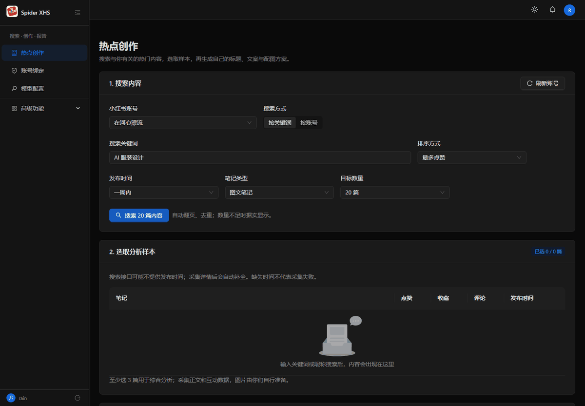
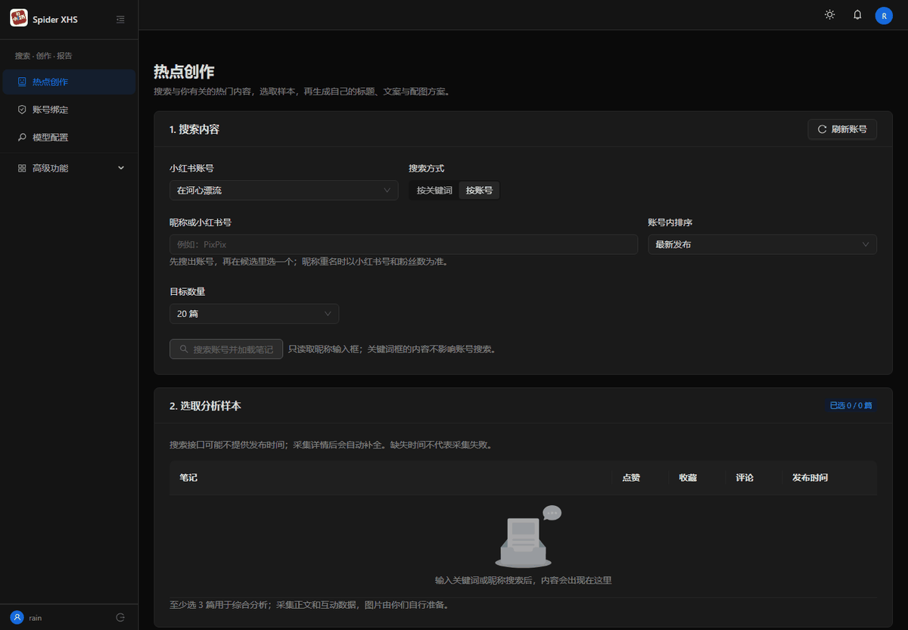
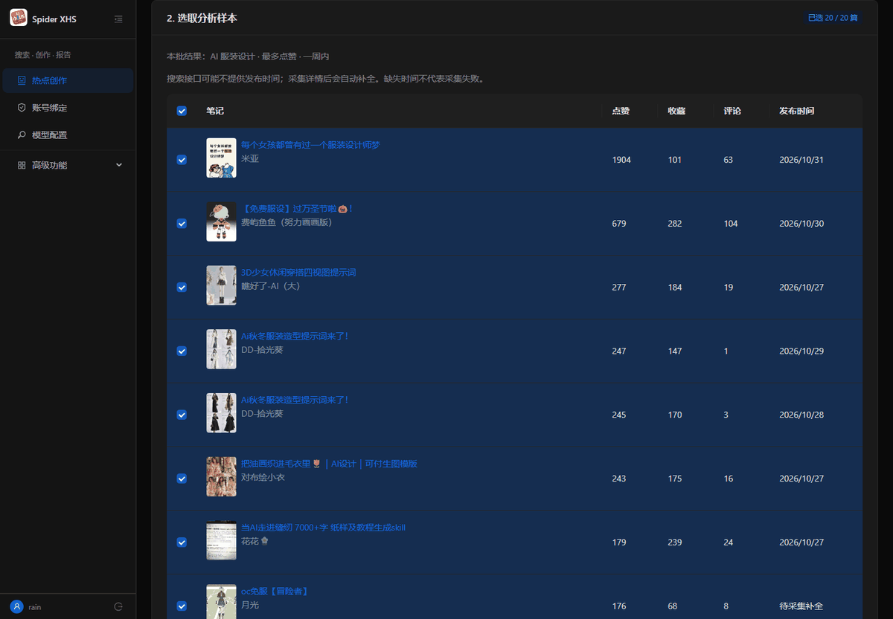
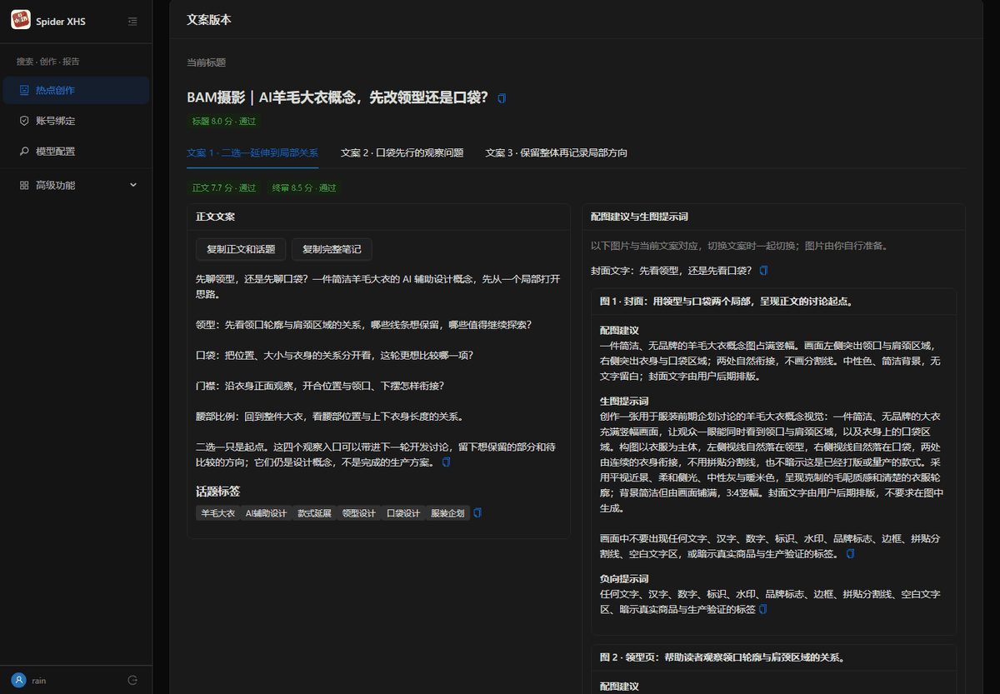
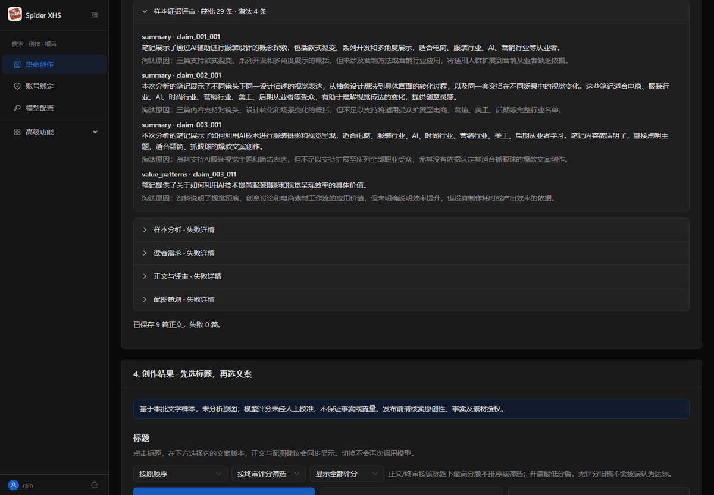
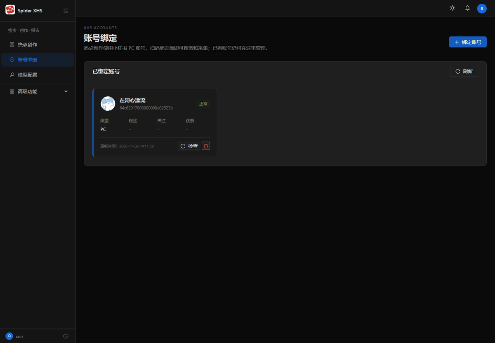
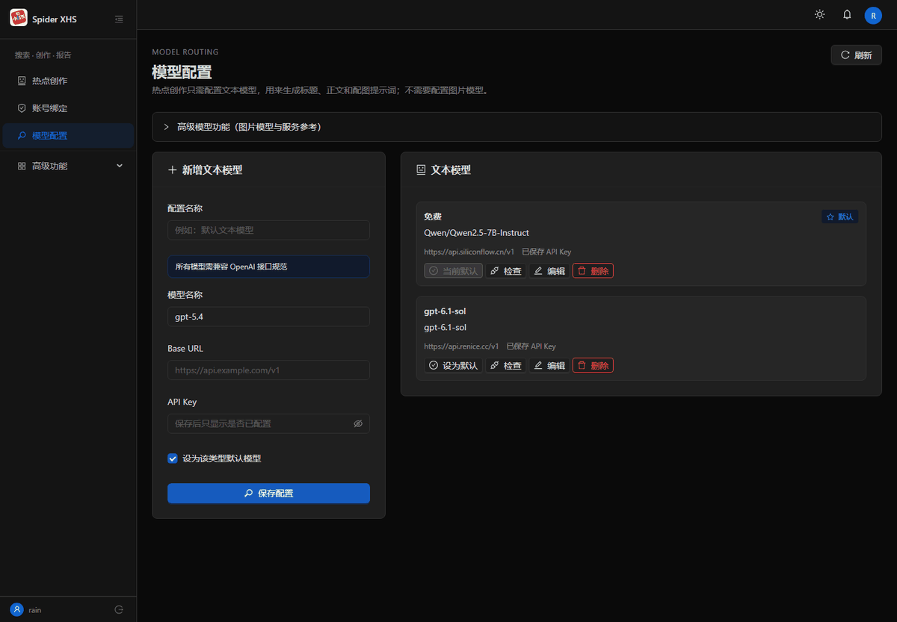

# 小红书一站式运营平台 · XHS_ALL_IN_ONE

一套面向小红书内容运营的本地工作台：**从选题调研到成稿出图，把"找素材 → 写内容 → 评审 → 出稿"整条链路收进一个界面**。

核心是「热点创作」流水线：输入关键词或某个账号，拉回一批笔记作为样本；人工筛出真正想参考的几篇；交给多阶段的 AI 流程做样本分析、读者需求、选题、标题、正文、配图方案和终审；评审不通过会自动返工，直到出稿或达到返工上限；最后导出一份可以直接拿去用的内容方案（HTML / JSON 报告）。

> ⚠️ 本项目仅供学习与技术交流，请勿用于任何商业化或违规用途。使用时请遵守平台规则，生成内容必须人工核实后再发布。

---

## 界面预览

**热点创作：关键词和账号两种搜索方式，各自独立填值**



**按账号搜索：先用昵称找账号，认准小红书号和粉丝数再选**



**样本列表：翻页去重后人工勾选，至少 3 篇才能进入生成**



**生成结果：每个标题多版文案，标题/正文/终审评分并列，配图提示词可直接使用**



**评审记录：每条结论是否采纳、被否原因，全部可追溯**



---

## 目录

- [界面预览](#界面预览)
- [核心能力](#核心能力)
- [快速开始](#快速开始)
- [第一次使用](#第一次使用)
- [热点创作怎么用](#热点创作怎么用)
- [生成流程说明](#生成流程说明)
- [配置说明](#配置说明)
- [项目结构](#项目结构)
- [技术栈](#技术栈)
- [常见问题](#常见问题)
- [文档索引](#文档索引)

---

## 核心能力

### 1. 两种样本来源：关键词 / 账号

- **按关键词**：输入关键词，自动翻页去重，一次拉取 20 / 30 / 50 条候选；
- **按账号**：输入昵称先搜出账号候选（展示小红书号、粉丝数、头像，避免重名选错），选中后拉取该账号最近最多 300 篇笔记，支持「最新发布」和「点赞最高」两种排序；
- 两种来源产出的数据结构一致，后续采集、筛选、生成、报告完全共用。

> 账号列表接口只返回标题、封面和互动数据，所以「在账号内按关键词筛选」是在已加载列表里按标题做的本地筛选，不会假装搜遍了整个账号——界面会明确写出命中范围。

### 2. 人工筛选环节

样本一定要人来挑：搜索结果里有什么、哪几篇值得参考，是运营判断而不是算法能替代的。页面提供封面、标题、点赞/收藏/评论、发布时间，勾选后才会进入采集。

### 3. 多阶段 AI 创作链路

默认使用 **LangGraph 分阶段流程**，13 个节点串成一条可回溯的状态图：

```
样本分析 → 样本证据评审 → 读者需求 → 选题 → 选题评审
        → 标题 → 标题评审 → 正文 → 正文评审
        → 配图方案 → 终审 → 返工计划 → 结果组装
```

- 评审结论决定返工回到哪一阶段，而不是整条重跑；
- 每个节点只能写自己声明的状态字段，越权写入会在运行时直接中断；
- 每个角色只收到本阶段需要的字段（上下文按角色裁剪），不相关的上游产物不进请求。

此外还保留两种生成方式供对照：

| 方式 | 说明 |
|---|---|
| **LangGraph（默认）** | 分阶段、可暂停/接续、批次缓存最完整 |
| 多 Agent（试用） | 早期实现，保留观察，后续可能移除 |
| 旧版一次综合生成（对照用） | 一次请求出全部结果，仅用于对比 |

### 4. 质量评审与定向返工

每个阶段都有独立评委，按 rubric 打分（0～10）并给出结构与字段级问题：

- 未通过项会定位到具体对象和字段，返工范围由代码强制约束；
- 已通过且文本未变的候选会「冻结判定」，不再重复送审；
- 每个生产阶段最多 3 轮返工，超限时保留草稿与评审记录，不会把未通过内容当最终成稿。

### 5. 长任务可暂停、可接续

- **暂停**：在下一个模型请求边界停下，已完成阶段和批次全部保留；
- **继续**：从暂停处重入，已完成的批次直接复用，不重跑前面内容；
- **从失败阶段继续**：模型服务失败、网络中断、执行超时等可恢复情况，可在累计请求次数未用尽时接续；
- **停止**：放弃任务，保留审计记录。

配合请求预算（按样本量自适应，72～512 次）、90 分钟执行窗口、每批 5 路并发和网络失败自动重试（最多额外 5 次，间隔 15/30/60/90/120 秒）。

### 6. 配图方案与生图提示词

- 每个标题的每版正文都有独立配图方案（数量可配置，如 5～9 张）；
- 支持填写「画面要求」（界面简洁、不要文字、不要留白、只做局部特写等）；
- 生图提示词会把构图、镜头、光线、色彩、材质、风格、比例整合成可直接使用的完整描述，并在结尾统一写明「画面中不要出现：…」，方便直接拿去文生图平台使用。

### 7. 成稿与报告

- 多标题 × 多版本结果并列展示，可切换、复制、查看评分明细；
- 一键导出 HTML / JSON 报告，含样本来源、样本分析、各阶段评分与问题、完整正文与配图提示词。

### 8. 平台其他能力

除热点创作外，工作台还包含：账号绑定（PC 扫码）、笔记发现、数据抓取与导出、关键词组、数据洞察、竞品监控、图片工坊、视频工坊、内容库、草稿工坊、发布中心、自动运营、任务中心与模型配置。

---

## 快速开始

### 环境要求

| 依赖 | 版本 |
|---|---|
| Python | 3.11+（开发环境使用 3.13） |
| Node.js | 20+（含 npm） |
| 数据库 | 默认 SQLite，无需额外安装；也支持 MySQL |

### 1. 安装后端依赖

```bash
python -m venv .venv

# Windows
.venv\Scripts\activate
# macOS / Linux
source .venv/bin/activate

pip install -r requirements.txt
```

### 2. 启动后端

```bash
python main.py
# 默认监听 http://127.0.0.1:8000
# 数据库会自动建表与迁移（SQLite 默认落在 data/spider_xhs.db）
```

可选参数：

```bash
python main.py --host 0.0.0.0 --port 8000 --reload   # 改监听地址 / 热重载
python main.py --with-frontend                        # 同时启动前端
```

### 3. 启动前端

```bash
cd frontend
npm install
npm run dev
# 打开 http://127.0.0.1:5178
```

前端开发服务器会把 `/api` 代理到 `http://127.0.0.1:8000`，两个端口都在本机即可。

> 也可以一条命令同时启动：`python main.py --with-frontend`（前端默认 5178，可用 `--frontend-port` 修改）。

---

## 第一次使用

1. **注册并登录**：打开前端页面，注册一个本地账号（数据保存在本机数据库）；
2. **绑定小红书账号**：进入「账号绑定」，用小红书 App 扫码登录 PC 账号（热点创作的搜索与采集都依赖它）；

   

3. **配置模型**：进入「模型配置」，添加一个**文字模型**（OpenAI 兼容接口：Base URL、API Key、模型名）。
   - 若使用中转站，填中转站地址即可；
   - 可选再配一个「轻量预处理模型」，只处理样本分批摘要，降低主模型消耗；

   

4. **开始创作**：进入「热点创作」，按下面的流程走。

---

## 热点创作怎么用

```
1. 搜索内容
   ├ 按关键词：输入关键词 → 搜索
   └ 按账号：输入昵称 → 选择账号（看小红书号/粉丝数）→ 可选「最新发布 / 点赞最高」
        ↓
2. 选取分析样本
   勾选至少 3 篇（可全选，也可只挑几篇）→「仅采集选中的 N 篇正文」
        ↓
3. AI 创作设置
   选择文字模型、生成数量（标题数 × 每标题版本数）、标题长度、
   配图数量区间、画面要求、目标受众、创作要求
        ↓
4. 生成与查看
   阶段进度 / 请求次数 / 实时状态 → 完成后查看多版本成稿与评分
   → 导出 HTML / JSON 报告
```

运行过程中可以随时**暂停**，之后点**继续**接着跑；失败时用「从失败阶段继续」，只补未完成的批次。

---

## 生成流程说明

### 阶段与产出

| 阶段 | 产出 |
|---|---|
| 样本分析 | 样本摘要、观察、选题/价值/避坑模式、风格特征 |
| 读者需求 | 受众分组、每组需求、形式建议与不确定性 |
| 选题 | 若干选题（角度、读者承诺、必须覆盖点、边界） |
| 标题 | 每个选题若干候选标题 |
| 正文 | 每个标题多版正文（含标签、引用绑定） |
| 配图 | 每版正文的配图方案与生图提示词 |
| 终审 | 标题-正文-配图一致性与事实边界检查 |

### 可靠性设计

- **批次缓存**：样本按 2～3 篇、标题按候选数、正文按锁定标题、配图与终审逐篇分批；每批带输入指纹，重跑只补缺失批次；
- **严格结构**：每次请求按当前合法 ID 动态生成 JSON Schema，越界引用在 Schema 层就被拒绝；程序再核对来源归属、逐字引用、数量与返工范围；
- **预算与窗口**：按样本量和输出批次估算请求上限，达到上限或 90 分钟窗口结束即停止新增请求，已产出内容照常保存；
- **错误可读**：网络超时、模型限流、结构不符、质量未达标都会给出可操作的下一步建议，而不是抛一个堆栈。

---

## 配置说明

默认配置在 `config/default.yaml`，支持两层覆盖：

1. `CONFIG_FILE` 环境变量指定的自定义 YAML；
2. 环境变量（最高优先级），例如：

| 配置项 | 环境变量 | 说明 |
|---|---|---|
| `server.host` / `server.port` | `SERVER_HOST` / `SERVER_PORT` | 后端监听地址与端口 |
| `database.type` | `DATABASE_TYPE` | `sqlite`（默认）/ `mysql` |
| `database.sqlite_path` | `DATABASE_SQLITE_PATH` | SQLite 文件位置 |
| `security.secret_key` | `SECRET_KEY` | 登录令牌签名密钥 |
| `security.fernet_key` | `FERNET_KEY` | Cookie 等敏感字段加密密钥 |

数据库首次启动会自动建表；已有表但没有迁移记录时会自动打标记，之后按 Alembic 迁移升级。

> 模型 API、账号 Cookie 都在页面里配置，加密后保存在数据库中，不需要写进配置文件。

---

## 项目结构

```
backend/app/
├── api/            # 接口层（xhs 平台、账号、任务、模型、认证）
├── services/       # 业务层：创作流水线、评测、报告、采集
│   └── creative_graph/   # LangGraph 流程：节点、批次、评审、恢复
├── adapters/       # 平台适配器（小红书 PC / Creator 登录、请求环境）
├── schemas/        # Pydantic 模型与请求/响应结构
├── models/         # 数据库模型
└── core/           # 配置、数据库、安全、日志
frontend/src/
├── pages/          # 页面（热点创作、账号、模型、内容库、发布…）
├── components/     # 布局与通用组件
├── lib/            # API 客户端与工具
└── types/          # 前端类型定义
config/             # 默认配置
tests/backend/      # 后端测试
docs/               # 设计文档与变更记录
```

---

## 技术栈

| 层 | 选型 |
|---|---|
| 后端 | Python 3.13 / FastAPI / SQLAlchemy / Alembic / APScheduler |
| AI 编排 | LangGraph / LangChain / Pydantic / 动态严格 JSON Schema |
| 前端 | React 19 / TypeScript / Vite / Ant Design |
| 存储 | SQLite（默认）/ MySQL |

---

## 常见问题

**Q：模型请求超时或报 524/502？**
中转站在并发高或请求较大时容易超时。系统已自动重试最多 5 次（间隔 15/30/60/90/120 秒）；仍失败时建议等几分钟后用「从失败阶段继续」，不要立刻重新生成。

**Q：任务跑到一半停了，怎么继续？**
在历史任务里打开它，点「从失败阶段继续」或「继续」（暂停的任务）。已完成的阶段和批次会复用，不会重跑。

**Q：为什么请求次数上限每次不一样？**
上限按样本数量和输出批量自适应估算（72～512 次），在页面进度里能看到已用/上限。

**Q：搜索结果很少或为空？**
先确认绑定的账号登录是否有效（账号页会显示状态），再换关键词或缩短筛选范围。

**Q：生成的标题/正文分数不高怎么办？**
评审用 6.5 分作为通过线，未通过会自动返工（每阶段最多 3 轮）。仍不通过时，可以调整创作要求、受众或换一批样本后重新生成。

**Q：账号模式为什么不能按正文关键词搜索？**
账号列表接口只提供标题、封面和互动数据，正文与标签要逐篇采集才有。为避免「假装搜全了账号」，账号内筛选只针对已加载列表的标题，界面上会写明命中范围。

**Q：数据存在哪里？**
默认在 `data/spider_xhs.db`；报告输出在报告目录，可在结果区下载。

---

## 文档索引

| 文档 | 内容 |
|---|---|
| `docs/langgraph-workflow.md` | LangGraph 流程设计与节点契约 |
| `docs/hot-content-guide.md` | 热点创作使用指南 |
| `docs/account-search-plan.md` | 按账号搜索的方案与决策记录 |
| `docs/creative-agent-plan.md` | 创作 Agent 与评审设计 |
| `docs/tasks/HANDOFF.md` | **交接状态**：当前进度、已知问题、换设备恢复步骤 |
| `docs/project-change-log.md` | 开发过程与变更记录 |
