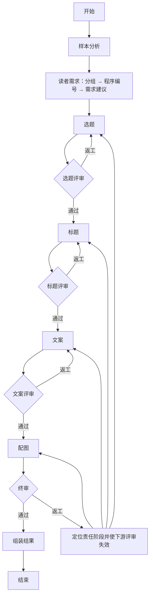

# LangGraph 创作流程实现说明

日期：2026-10-23（北京时间）。本说明对应新增的可切换实现，原 `legacy` 和 `multi_agent` 流程保留。L1：`342bbe7`；L2：`8af251d`；L3：API、页面和数据库快照接入已完成，随 `feat: 接入可切换的 LangGraph 创作与状态持久化` 归档。

页面默认保持此前生成方式，在“高级生成选项”选择“LangGraph 分阶段创作与评审（试用）”后，请求携带 `analysis.workflow=langgraph`。请求前后及节点结束时，`creative_runner.py` 将完整可序列化状态保存到 `Task.payload.graph_state`，并在同一数据库提交中保存兼容的 `pipeline`；失败、取消和服务重启中断同样更新快照。报告沿用版本 3 的阶段/评审结构，避免额外复制一份全局状态；用户归属和文件下载权限仍执行现有检查。

## 1. 状态与职责

`backend/app/services/creative_graph/state.py` 手写 `CreativeGraphState(TypedDict)`，集中保存搜索参数、样本、创作配置、十个角色的产物/评审、返工计划、进度记录和最终结果。各节点有独立的局部更新 TypedDict：

| 节点 | 可更改的业务字段 |
| --- | --- |
| 样本分析 | `sample_analysis` |
| 读者需求 | `audience` |
| 选题 / 选题评委 | `topic` / `topic_review` |
| 标题 / 标题评委 | `title` / `title_review` |
| 文案 / 文案评委 | `copy` / `copy_review` |
| 配图 / 终审 | `image` / `final_review` |
| 返工控制 | `revision_plan`、失效的下游评审 |
| 结果组装 | `result`、`metadata` |

节点还可以更新 `pipeline` 审计快照和 `revision_plan`。节点接收输入状态的副本，返回局部更新；运行时检查返回字段是否属于其更新 TypedDict，越权写入立即停止。业务产物只从 StateGraph 当前状态读取，持久化镜像不作为另一套消息管道。

## 2. 每个 Agent 的结构化响应

`backend/app/schemas/creative_graph.py` 手写各角色响应 TypedDict 及嵌套类型；读者需求内部另分为受众分组响应和动态限定 ID 的需求响应（见第 8 节）。`agents.py` 逐一构建，例如：

```python
StructuredAgent(
    model, COPY_AGENT,
    response_format=responses.CopyResponse,
    output_model=legacy.CopyVariants,
    state_fields=("input_fingerprint",),
)
```

`StructuredAgent` 是本项目的无工具角色封装，内部调用 LangChain 模型的 `with_structured_output(TypedDict, method="json_schema", strict=True)`。`model.py` 继承 LangChain `BaseChatModel`，把完整 Schema 作为原生 `response_format` 请求参数传给已有兼容接口；单次角色调用只发送一次模型请求。这里没有采用会额外调用一次格式化模型的 ReAct 工具循环。

Schema 通过 TypeAdapter 从 TypedDict 生成，保留 Annotated 长度、数量和枚举约束，再由 LangChain 转换；响应必须是完整 JSON，经 TypedDict 运行时校验后适配旧 Pydantic 业务检查。模型和服务端必须支持严格 JSON Schema，不能以 HTTP 200 推断其能力；不支持时明确失败，不静默降级重发。

版本号、输入指纹、总分、通过名单和标题选优是程序字段。模型只返回本角色的内容或评分，程序从当前调用的状态绑定版本和指纹，避免要求模型抄写哈希造成无意义的交接失败。来源、数量、对象 ID、原文引用及返工范围仍需业务检查，框架和 Schema 不能证明这些关系或内容质量。

## 3. 实际图结构

`workflow.py` 使用 `StateGraph(CreativeGraphState)`、`add_node`、`add_edge`、`add_conditional_edges` 和 `compile()` 构建图。评审通过/返工由条件边选择：



终审返工保留完整稿件，只修改问题对应 ID。选题修改会影响同组选题下的标题/正文/配图；标题变更或改选会重新绑定同组正文和图片；正文修改会更新对应配图。无关内容保持原文。每个角色从全局状态选取必要输入，模型不接收数据库会话、凭证、文件句柄或不需要的工具。

## 4. 限制与错误处理

- 首轮全部通过的请求数为 7 次其他调用，加上标题评审批次数、正文评审批次数以及逐篇配图/终审批次数。每选题 5 个标题候选时，公式为 `7 + 2 × 选题数 + 2 × 选题数 × 正文版本数`；默认 3 选题 × 3 版本为 31 次，最大 5 × 3 为 47 次。新建 LangGraph 任务上限为 72 次；旧快照保留原上限，原 `multi_agent` 保持 36 次。每个生产阶段最多两次质量返工，30 分钟后不再开始新请求，单次连接/读取超时仍为 10/180 秒。
- 格式修复最多一次，与质量返工分开计数；修复也传相同 Schema。临时网络故障（连接/读取超时、连接中断、HTTP 408/429/500/502/503/504/524）在当前请求最多额外重试 3 次，合计最多 4 次，通常等待 15/30/60 秒。服务端 Retry-After 更长时遵循其等待时间；超过 300 秒则停止自动重试，避免提前重发。400/401/403、Schema 不支持、结构/业务错误不进入网络重试。
- 每次网络请求都计入任务记录的总预算；等待中每秒检查取消和 30 分钟预算，预算或取消优先于重试。每次读取超时仍是 180 秒，自动重试可能增加总时间与费用，已超时请求可能在上游完成。进度和 `stages.*.metadata.network_attempts` 保存角色、尝试次数、耗时、原因与重试安排，终端输出同样带任务关联。
- `creative_schema_invalid`：JSON 或 TypedDict 字段不符合；`creative_handoff_invalid`：来源/数量/ID/返工范围等动态检查失败；`creative_quality_exhausted`：内容评审达到返工上限。进度快照保留区分后的原因和尝试记录。
- 请求前后、节点完成和错误退出都保存状态；停止与异常竞争时优先保存停止状态。已发出的模型请求不能撤回，停止后不提交最终结果。
- 保留单进程后台任务和重启后标记中断的行为；没有 LangGraph checkpointer、重启自动续跑或分布式调度。新增的是用户主动发起、基于已保存完整全局状态的模型失败接续，见下一节。
- 未自动调用真实模型、小红书、生图或发布接口。离线验收不能替代真实标题、文案和图片方案的人工可用度验收。

## 5. 从模型失败处继续

`POST /api/xhs/creative/runs/{task_id}/resume` 无需提供素材、状态或创作参数。仅允许当前用户自己的失败 LangGraph 任务，错误需属于模型连接/读取/HTTP/响应解析问题；素材、Schema、业务交接、质量、取消、预算耗尽和缺失快照不允许从此入口绕过。页面任务详情通过 `resume_available` 显示“从失败阶段继续”。HTTP 鉴权/参数错误可以先修正原模型配置再手动接续，但不自动重试。

接口从服务器保存的 `graph_state` 创建关联分析子任务，保留父任务失败记录，校验搜索、素材、创作配置和快照一致性。使用原模型配置 ID、标题/正文数量和创作要求；修改创作要求需重新生成，不能把旧评审用于新要求。生产者和评委分别定位，例如标题已生成、标题评审遇到 524 时只从标题评审启动。更早的快照没有 failed_role 时根据当前稿件与待返工计划推断；不完整快照拒绝接续。

新图通过 START 条件边进入恢复节点，继续使用全局 TypedDict、节点局部更新、后续评审和定向返工边。前面的结果直接复用，失败的生产者若正处于质量返工，则保留相同对象范围和已计入的返工次数；网络失败不额外消耗质量返工机会。

所有网络重试和接续累计计入原链路记录的请求上限，不清零或自动扩容；旧任务即使升级代码也保留原 36 次上限，新任务为 72 次。每次主动接续重新开始 30 分钟执行时间窗口。预算耗尽必须新建分析任务。接口通过事务和乐观更新避免重复点击创建多个并行接续子任务；重复请求返回已存在的等待/运行/完成子任务，已失败子任务要从其自己的详情继续。

`resume_available` 只表示快照与错误满足接续条件，不保证模型配置仍有效或下一次请求成功。接续不会重新采集、自动更换模型或跳过内容评审；可能再次产生模型费用。

## 6. 标题评审的请求减压

本轮针对出现 524 的标题评审节点减压。标题生成完成后，图按选题构造轻量评审输入：关键词、创作要求、当前选题、对应受众摘要、标题风格摘要、候选标题和固定 rubric，移除重复的完整上游分析。每个请求最多评审 5 个候选；同一选题的 6、7、8 个候选分别拆成 3+3、4+3、4+4，避免留下没有比较对象的单项批次。

标题评委使用独立的 `TitleReviewResponse` TypedDict，只返回六项分数、简短评论、问题、保留点和候选比较。程序随后将它适配回既有 `ItemReviewResponse`，继续执行字段引用、引句、低分问题、完整覆盖和确定性选优检查；总分、通过状态和最终选中的标题仍由程序计算，不交给模型决定。标题评审的原生 JSON Schema 仍通过模型的 `response_format` 参数传递，提示词不再重复嵌入完整 Schema。

每个已完成批次以输入指纹写入 `pipeline.stages.title.metadata.title_review_batches`。失败接续或同一节点重试时，已经完成且仍匹配当前输入版本的批次直接复用，只调用未完成批次；输入、版本或业务校验不匹配时缓存自动失效。该策略通常把一次约 15 个标题的大请求变成多个小请求，目标是减轻单次请求负载；真实 524/读取超时能否减少仍待试用。3 个选题大致会产生 3 次标题评审调用，总请求数从 10 次增加到 12 次左右，仍受全局 36 次预算约束。同一选题超过 5 个候选时只在各自批次内比较差异，跨批候选差异暂不由评委直接比较。

## 7. 样本引用失败的原句诊断

2026-10-22 按用户要求扩展此前只记录位置/原因的诊断。样本分析的 `observations[*].quote` 或四类 patterns 的 `evidence[*].quote` 未通过连续原文校验时，终端增加“原文引用不匹配”事件，携带任务、角色和尝试序号；同时把 `quote_diagnostic` 存入尝试轨迹。两次校验均失败时，它随 `metadata.failed_attempts` 持久化，页面“失败详情 → 模型原句与原文对照”可以展开、复制；修复成功的尝试轨迹仍随阶段历史保存。

诊断同时保留结构校验前的模型引句和校验实际使用的引句，避免 TypedDict/Pydantic 的首尾空白处理掩盖差异。模型引句最多 600 字，超过时记录原长度和截断标记；对应样本的标题和独立正文片段各取最多 360 字的近似对照窗口，提供字段、片段下标、窗口偏移、空白/兼容字符归一化后的匹配提示及最多 12 个字符差异块。差异块中的模型/原文文本各最多 80 字，长块有截断标记。换行、制表符以 JSON 转义形式显示。

近似窗口仅辅助排查，不证明模型原本想引用该处；正文首尾片段不会拼成一段，归一化提示也不改变逐字引用的通过规则。原句捕获使用调用级上下文，在异常后恢复，避免不同尝试/任务串用；不记录完整模型响应、提示词或模型凭证。旧任务没有保存原句，无法回溯补出。这次改动覆盖 LangGraph 和原多 Agent 的样本分析，不改变重试次数、评分或业务校验规则。

## 8. 读者需求的两步生成与局部修复

2026-10-22 针对 80 号试用任务的受众覆盖遗漏、未知/重复分组引用改造。`services/creative_graph/audience.py` 在原 `audience` 图节点内执行两个独立结构化调用，分别使用专用角色提示词；对外仍只更新 `AudienceUpdate` 允许的 `audience`、`pipeline` 和 `revision_plan`，不新增全局字段或恢复角色，兼容已有任务快照。

第一步使用手写 `AudienceGroupingResponse(TypedDict)`，只让模型生成受众分组的语义内容，不要求返回用户词总表或分组 ID。程序校验每组受众词和证据来源，反馈具体缺少的受众词与错误字段；全部覆盖后按组顺序分配 `segment_1`、`segment_2` 等 ID，并原样回填用户受众词。

第二步在构建 Agent 时明确 `response_format=AudienceNeedsResponse`。该类及嵌套类均继承 `TypedDict`，按本次合法 ID 特化引用字段的 `Literal`，真实请求的 `response_format.json_schema.schema` 包含合法 ID 枚举（单 ID 时为 `const`）和 `uniqueItems: true`。本地 TypeAdapter 同时检查合法值与唯一性，不能仅依赖模型服务执行 Schema。模型只写共性需求、形式建议、摘要和限制；程序合并回既有 `AudienceBrief` 后继续执行来源、受众覆盖和上下游检查，Schema 不替代这些业务校验。

每步仍最多两次结构/交接尝试。第一次出错时，逐项检查并保留合格分组、需求、建议和顶层文字，把错误字段、缺失词、收到的错误 ID、合法 ID 和待补数量反馈给第二次调用。修复请求只需返回替换/新增的列表项；无需补充的列表可返回空列表，合格部分由程序合并，顶层已通过文字保持不变。最终需求与建议仍至少一项，且不能通过删掉坏项目来跳过应补数量。若模型把八个分组名额用在过细的分组上，只释放补齐全部用户受众所必需的尾部分组名额，并告知需要重新合并的词。

`pipeline.stages.audience.metadata.audience_steps` 保存版本、输入指纹、已校验分组、合格分析和待补数量；分析另绑定完整分组内容的指纹，避免 ID 相同而分组语义已变时误用旧建议。复用前重新校验；需求调用失败或修复途中断网后，从原 `audience` 角色接续时复用分组并补齐尚未完成的分析。沿用原接续资格：只有模型服务/连接类失败可手动继续，Schema、业务、素材、质量或预算失败仍不能绕过检查。旧任务没有这些中间结果时，从该节点完整执行两步。

终端增加“受众分组局部修复”和“受众需求局部修复”事件，显示具体缺失词、错误位置、错误/合法 ID 与已接受项目数；分组和分析的调用日志分别显示子步骤名称。TypedDict 拒绝的解析对象只在当前调用内用于筛选合格项，不持久化完整失败响应。修复仍受全局请求预算、网络重试、取消和超时约束；正常链路比此前增加一次模型请求。应用已提供本地试用入口，真实模型成功率和成稿可用度尚待用户验收。

## 9. 正文评审按锁定标题分批

2026-10-23，85 号真实 LangGraph 任务已经生成 9 篇正文，`copy_review` 连续四次请求各约 127 秒后收到 HTTP 524，未返回评分。重建其输入约 2.6 万字符（用户消息含重复 Schema，不含独立的系统消息和 API Schema 参数）；正文与评审在页面同属一阶段，不能据页面阶段名推断正文生成也失败。

新增 `services/creative_graph/copy_review.py`，在原 `copy_review` 图节点内，按当前锁定标题将对应的 2～3 版正文放在同一批比较。每批保留该组选题、锁定标题的承诺/支撑点、主要受众摘要、相关样本的风格/价值/避坑依据及限制；移除完整受众分析、其他选题和标题、无关样本及重复 Schema 文本。正文、标签、覆盖点、来源完整保留，样本依据的引句不截断；原生 JSON Schema 继续通过实际 `response_format` 传参。`CopyReviewResponse(TypedDict)` 的 `reviews` 数量约束同步收紧至 2～3，运行时校验与独立角色提示词仍生效，不采用隐藏格式化调用或降级。

使用相同 85 号快照离线重建，三批用户消息分别为 8262、8195、8379 字符，每批 3 个对象、18 项评分，原先单次为 9 个对象、54 项评分。这是请求规模比较，不是已测得的性能或成功率。评分项目、门槛、阻断规则、逐字引句、来源和对象覆盖校验均不变；每批先校验，再合并为原来的 `ItemReviewResponse`，绑定原完整输入指纹并重验全部对象覆盖与确定性评分，确保后续配图仍验证同一正文集合。关联版本只允许引用同批同标题的其他版本。

批次结果保存至 `pipeline.stages.copy.metadata.copy_review_batches`，含版本、原完整输入指纹与按批指纹索引的已校验响应。每次执行先重验缓存，清除损坏、版本/输入不匹配和多余结果；模型错误接续时仅调用未完成批次。正文/标题/风格/版本变化导致旧评审失效，不跨版本复用；已完成的一批即使包含不通过的版本，也先保存并评完其余批次，再走既有质量返工条件边，不跳过坏版本。

进度显示“文案评委 Agent · 评审批次 1/3”和完成批次数；终端模型调用记录批次下标、对象数、评分数量，复用时新增“复用正文评审批次”事件。旧失败快照没有批次缓存时自动从第一批评起，因此 85 号任务可通过现有“从失败阶段继续”入口复用前面阶段及 9 篇正文；不会修改原失败记录或重新采集。仍遵守累计 36 次预算、网络额外重试 3 次、180 秒单请求读取超时和取消逻辑。默认 3 选题正常链路从上轮 13 次增加到 15 次；虽然单次负载下降，总调用数与费用可能增加，真实效果待用户试用。旧 `legacy`、`multi_agent`、前端默认生成方式及报告格式不变。

## 10. 配图与终审逐篇处理

2026-10-23，86 号任务已生成 9 篇正文并完成正文评审，配图阶段连续三次在约 127 秒返回 524，随后触发整条流程 30 分钟预算。新增 `visual_batches.py`，在原 `image` 和 `final_review` 图节点内部按 `variant_id` 顺序执行，每次只处理一篇正文；不新增全局业务字段或恢复角色。

配图请求保留当前选题、锁定标题、完整正文/标签/来源、用户要求和视觉偏好；移除其他正文与选题。手写 `ImageResponse(TypedDict)` 的 variants 固定一项，专用内部 `ImageBatchOutput` 接受单项批次，合并后仍使用要求完整 2～15 项的原 `ImagePlans`，重验指纹、覆盖、顺序和绑定。每篇仍可给 1～6 张具体图片方案，不为缩短请求截断提示词。86 号输入离线重建从 10447 字符变为 9 批，每批 2195～2412 字符（仅输入对象，不含系统消息与 API Schema）；不代表真实耗时或成功率。

终审请求保留当前完整的选题、标题、正文、标签、配图和素材说明，以及相关样本文字证据与字段责任表；移除在上下文中重复的正文/配图集合。`FinalReviewResponse(TypedDict)` 的 reviews 固定一项，评分、低分问题、引句、来源与责任阶段检查继续执行；全部批次合并后，用原完整输入再次校验覆盖及质量判定，再走原条件路由。逐篇终审不比较跨篇重复性；正文阶段的同标题版本比较仍保留。两类角色均通过实际 `response_format` 传原生 Schema，用户消息不重复嵌入 Schema。

`batch_runner.py` 将合格结果保存于 `stages.image.metadata.image_batches` 和 `stages.final_review.metadata.final_review_batches`，按批指纹索引，另绑定完整输入、策略版本及返工指纹。接续前重新检查缓存，丢弃损坏、过期或多余项；只补未完成批次。进度显示当前篇数、完成/复用篇数，终端输出相同批次定位。完整配图/终审业务状态只在所有批次完成后提交；中途取消或失败保留先前稿件与已完成批次。

配图返工只发送目标 variant，携带该篇旧配图与相关反馈，其余图片由程序原样保留；合并后再执行全量返工范围校验。上游修改或改选标题仍按原依赖规则重新绑定。默认 3 选题 × 3 版本首轮从 15 增至 31 次调用；最大配置需 47 次，所以新任务预算设为 72 次，旧任务预算不升级，30 分钟/180 秒和重试规则不变。费用与总耗时可能增加，仍需真实试用；86 号记录为预算耗尽，不能用模型失败接续入口，可选择已有采集内容新建生成任务。原任务不被修改或自动续跑。

## 11. 按角色裁剪上下文

原始采集正文只进入样本分析，且原实现已经按预算提取首尾片段，并非把全文传遍所有节点。读者需求使用样本分析简报；这次继续解决后续生产节点重复携带整份分析、受众证据和重复 Schema 的问题。

新增 `context.py`，在模型调用前为选题/标题/正文构造字段白名单投影，完整样本、来源和上游产物保留在服务器全局状态中，用于指纹、业务校验、报告和恢复。投影不修改原始数据、不重新调用模型生成摘要、不按字符硬截断事实或风格句子；现有分析结论作为简报使用。未使用的字段即使将来加入全局状态，也不会自动进入这些请求。

| 角色 | 实际接收的样本信息 |
| --- | --- |
| 样本分析 | 采集正文的有界片段与元数据 |
| 读者需求 | 样本分析简报和可核对的分析引句 |
| 选题 | 主题/读者价值观察、主题/价值/避坑结论、来源 ID 和受众需求摘要，移除原文引句与表达风格证据 |
| 标题 | 标题风格结论、风格摘要、选题承诺/边界、相关读者摘要，不带样本逐篇观察和原文引句 |
| 正文 | 口吻、开头、段落、表情、结尾等风格结论、避坑、锁定标题承诺、选题要点、相关读者摘要，不带原文引句或上游完整评审 |
| 配图 | 当前成稿、锁定标题、选题边界和视觉偏好，无样本分析或采集正文 |
| 评审 | 当前评审对象与必要样本分析/证据；正文与终审按相关来源裁剪，标题按风格摘要判断 |

生产角色提示词明确简报是分析结论、来源 ID 不等于原文，不得声称读过完整原文或原图。选题、标题、正文和选题评审也停止在用户消息中重复嵌入输出 Schema，原生 `response_format` 及运行时校验保留。返工仍携带必要的旧稿和评审反馈，以执行只修改目标对象的范围约束。评审基于分析引句而非完整原文，不等同全文事实核查或抄袭检测。
