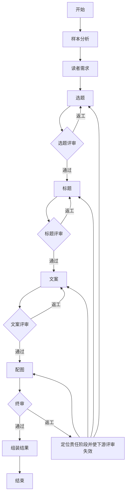

# LangGraph 创作流程实现说明

日期：2026-10-22（北京时间）。本说明对应新增的可切换实现，原 `legacy` 和 `multi_agent` 流程保留。L1：`342bbe7`；L2：`8af251d`；L3：API、页面和数据库快照接入已完成，随 `feat: 接入可切换的 LangGraph 创作与状态持久化` 归档。

页面默认保持此前生成方式，在“高级生成选项”选择“LangGraph 分阶段创作与评审（试用）”后，请求携带 `analysis.workflow=langgraph`。请求前后及节点结束时，`creative_runner.py` 将完整可序列化状态保存到 `Task.payload.graph_state`，并在同一数据库提交中保存兼容的 `pipeline`；失败、取消和服务重启中断同样更新快照。报告沿用版本 3 的阶段/评审结构，避免额外复制一份全局状态；用户归属和文件下载权限仍执行现有检查。

## 1. 状态与职责

`backend/app/services/creative_graph/state.py` 手写 `CreativeGraphState(TypedDict)`，集中保存搜索参数、样本、创作配置、十个角色的产物/评审、返工计划、进度记录和最终结果。各节点有独立的局部更新 TypedDict：

| 节点 | 可更改的业务字段 |
| --- | --- |
| 样本分析 | `sample_analysis` |
| 读者需求 | `audience` |
| 选题 / 选题评委 | `topic` / `topic_review` |
| 标题 / 标题评委 | `title` / `title_review` |
| 文案 / 文案评委 | `copy` / `copy_review` |
| 配图 / 终审 | `image` / `final_review` |
| 返工控制 | `revision_plan`、失效的下游评审 |
| 结果组装 | `result`、`metadata` |

节点还可以更新 `pipeline` 审计快照和 `revision_plan`。节点接收输入状态的副本，返回局部更新；运行时检查返回字段是否属于其更新 TypedDict，越权写入立即停止。业务产物只从 StateGraph 当前状态读取，持久化镜像不作为另一套消息管道。

## 2. 每个 Agent 的结构化响应

`backend/app/schemas/creative_graph.py` 手写十个独立响应 TypedDict 及嵌套类型。`agents.py` 逐一构建，例如：

```python
StructuredAgent(
    model, COPY_AGENT,
    response_format=responses.CopyResponse,
    output_model=legacy.CopyVariants,
    state_fields=("input_fingerprint",),
)
```

`StructuredAgent` 是本项目的无工具角色封装，内部调用 LangChain 模型的 `with_structured_output(TypedDict, method="json_schema", strict=True)`。`model.py` 继承 LangChain `BaseChatModel`，把完整 Schema 作为原生 `response_format` 请求参数传给已有兼容接口；单次角色调用只发送一次模型请求。这里没有采用会额外调用一次格式化模型的 ReAct 工具循环。

Schema 通过 TypeAdapter 从 TypedDict 生成，保留 Annotated 长度、数量和枚举约束，再由 LangChain 转换；响应必须是完整 JSON，经 TypedDict 运行时校验后适配旧 Pydantic 业务检查。模型和服务端必须支持严格 JSON Schema，不能以 HTTP 200 推断其能力；不支持时明确失败，不静默降级重发。

版本号、输入指纹、总分、通过名单和标题选优是程序字段。模型只返回本角色的内容或评分，程序从当前调用的状态绑定版本和指纹，避免要求模型抄写哈希造成无意义的交接失败。来源、数量、对象 ID、原文引用及返工范围仍需业务检查，框架和 Schema 不能证明这些关系或内容质量。

## 3. 实际图结构

`workflow.py` 使用 `StateGraph(CreativeGraphState)`、`add_node`、`add_edge`、`add_conditional_edges` 和 `compile()` 构建图。评审通过/返工由条件边选择：



终审返工保留完整稿件，只修改问题对应 ID。选题修改会影响同组选题下的标题/正文/配图；标题变更或改选会重新绑定同组正文和图片；正文修改会更新对应配图。无关内容保持原文。每个角色从全局状态选取必要输入，模型不接收数据库会话、凭证、文件句柄或不需要的工具。

## 4. 限制与错误处理

- 首轮全部通过为 10 次请求；每个生产阶段最多两次质量返工，最多 36 次请求，30 分钟后不再开始新请求，单次连接/读取超时仍为 10/180 秒。
- 格式修复最多一次，与质量返工分开计数；修复也传相同 Schema。超时、网络错误和 HTTP 拒绝直接停止。
- `creative_schema_invalid`：JSON 或 TypedDict 字段不符合；`creative_handoff_invalid`：来源/数量/ID/返工范围等动态检查失败；`creative_quality_exhausted`：内容评审达到返工上限。进度快照保留区分后的原因和尝试记录。
- 请求前后、节点完成和错误退出都保存状态；停止与异常竞争时优先保存停止状态。已发出的模型请求不能撤回，停止后不提交最终结果。
- 当前保留已有的单进程后台任务与重启后标记中断行为。序列化快照用于追溯，不代表已经实现 LangGraph checkpointer 自动断点续跑或分布式调度。
- 未自动调用真实模型、小红书、生图或发布接口。离线验收不能替代真实标题、文案和图片方案的人工可用度验收。
