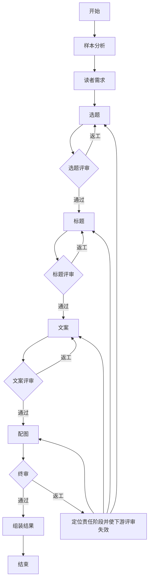

# LangGraph 创作流程实现说明

日期：2026-10-22（北京时间）。本说明对应新增的可切换实现，原 `legacy` 和 `multi_agent` 流程保留。L1：`342bbe7`；L2：`8af251d`；L3：API、页面和数据库快照接入已完成，随 `feat: 接入可切换的 LangGraph 创作与状态持久化` 归档。

页面默认保持此前生成方式，在“高级生成选项”选择“LangGraph 分阶段创作与评审（试用）”后，请求携带 `analysis.workflow=langgraph`。请求前后及节点结束时，`creative_runner.py` 将完整可序列化状态保存到 `Task.payload.graph_state`，并在同一数据库提交中保存兼容的 `pipeline`；失败、取消和服务重启中断同样更新快照。报告沿用版本 3 的阶段/评审结构，避免额外复制一份全局状态；用户归属和文件下载权限仍执行现有检查。

## 1. 状态与职责

`backend/app/services/creative_graph/state.py` 手写 `CreativeGraphState(TypedDict)`，集中保存搜索参数、样本、创作配置、十个角色的产物/评审、返工计划、进度记录和最终结果。各节点有独立的局部更新 TypedDict：

| 节点 | 可更改的业务字段 |
| --- | --- |
| 样本分析 | `sample_analysis` |
| 读者需求 | `audience` |
| 选题 / 选题评委 | `topic` / `topic_review` |
| 标题 / 标题评委 | `title` / `title_review` |
| 文案 / 文案评委 | `copy` / `copy_review` |
| 配图 / 终审 | `image` / `final_review` |
| 返工控制 | `revision_plan`、失效的下游评审 |
| 结果组装 | `result`、`metadata` |

节点还可以更新 `pipeline` 审计快照和 `revision_plan`。节点接收输入状态的副本，返回局部更新；运行时检查返回字段是否属于其更新 TypedDict，越权写入立即停止。业务产物只从 StateGraph 当前状态读取，持久化镜像不作为另一套消息管道。

## 2. 每个 Agent 的结构化响应

`backend/app/schemas/creative_graph.py` 手写十个独立响应 TypedDict 及嵌套类型。`agents.py` 逐一构建，例如：

```python
StructuredAgent(
    model, COPY_AGENT,
    response_format=responses.CopyResponse,
    output_model=legacy.CopyVariants,
    state_fields=("input_fingerprint",),
)
```

`StructuredAgent` 是本项目的无工具角色封装，内部调用 LangChain 模型的 `with_structured_output(TypedDict, method="json_schema", strict=True)`。`model.py` 继承 LangChain `BaseChatModel`，把完整 Schema 作为原生 `response_format` 请求参数传给已有兼容接口；单次角色调用只发送一次模型请求。这里没有采用会额外调用一次格式化模型的 ReAct 工具循环。

Schema 通过 TypeAdapter 从 TypedDict 生成，保留 Annotated 长度、数量和枚举约束，再由 LangChain 转换；响应必须是完整 JSON，经 TypedDict 运行时校验后适配旧 Pydantic 业务检查。模型和服务端必须支持严格 JSON Schema，不能以 HTTP 200 推断其能力；不支持时明确失败，不静默降级重发。

版本号、输入指纹、总分、通过名单和标题选优是程序字段。模型只返回本角色的内容或评分，程序从当前调用的状态绑定版本和指纹，避免要求模型抄写哈希造成无意义的交接失败。来源、数量、对象 ID、原文引用及返工范围仍需业务检查，框架和 Schema 不能证明这些关系或内容质量。

## 3. 实际图结构

`workflow.py` 使用 `StateGraph(CreativeGraphState)`、`add_node`、`add_edge`、`add_conditional_edges` 和 `compile()` 构建图。评审通过/返工由条件边选择：



终审返工保留完整稿件，只修改问题对应 ID。选题修改会影响同组选题下的标题/正文/配图；标题变更或改选会重新绑定同组正文和图片；正文修改会更新对应配图。无关内容保持原文。每个角色从全局状态选取必要输入，模型不接收数据库会话、凭证、文件句柄或不需要的工具。

## 4. 限制与错误处理

- 首轮全部通过的请求数为 9 次其他角色调用加上标题评审批次数（默认每选题 5 个候选，3 个选题共 12 次）；每个生产阶段最多两次质量返工，最多 36 次请求，30 分钟后不再开始新请求，单次连接/读取超时仍为 10/180 秒。
- 格式修复最多一次，与质量返工分开计数；修复也传相同 Schema。临时网络故障（连接/读取超时、连接中断、HTTP 408/429/500/502/503/504/524）在当前请求最多额外重试 3 次，合计最多 4 次，通常等待 15/30/60 秒。服务端 Retry-After 更长时遵循其等待时间；超过 300 秒则停止自动重试，避免提前重发。400/401/403、Schema 不支持、结构/业务错误不进入网络重试。
- 每次网络请求都计入原有 36 次总预算；等待中每秒检查取消和 30 分钟预算，预算或取消优先于重试。每次读取超时仍是 180 秒，自动重试可能增加总时间与费用，已超时请求可能在上游完成。进度和 `stages.*.metadata.network_attempts` 保存角色、尝试次数、耗时、原因与重试安排，终端输出同样带任务关联。
- `creative_schema_invalid`：JSON 或 TypedDict 字段不符合；`creative_handoff_invalid`：来源/数量/ID/返工范围等动态检查失败；`creative_quality_exhausted`：内容评审达到返工上限。进度快照保留区分后的原因和尝试记录。
- 请求前后、节点完成和错误退出都保存状态；停止与异常竞争时优先保存停止状态。已发出的模型请求不能撤回，停止后不提交最终结果。
- 保留单进程后台任务和重启后标记中断的行为；没有 LangGraph checkpointer、重启自动续跑或分布式调度。新增的是用户主动发起、基于已保存完整全局状态的模型失败接续，见下一节。
- 未自动调用真实模型、小红书、生图或发布接口。离线验收不能替代真实标题、文案和图片方案的人工可用度验收。

## 5. 从模型失败处继续

`POST /api/xhs/creative/runs/{task_id}/resume` 无需提供素材、状态或创作参数。仅允许当前用户自己的失败 LangGraph 任务，错误需属于模型连接/读取/HTTP/响应解析问题；素材、Schema、业务交接、质量、取消、预算耗尽和缺失快照不允许从此入口绕过。页面任务详情通过 `resume_available` 显示“从失败阶段继续”。HTTP 鉴权/参数错误可以先修正原模型配置再手动接续，但不自动重试。

接口从服务器保存的 `graph_state` 创建关联分析子任务，保留父任务失败记录，校验搜索、素材、创作配置和快照一致性。使用原模型配置 ID、标题/正文数量和创作要求；修改创作要求需重新生成，不能把旧评审用于新要求。生产者和评委分别定位，例如标题已生成、标题评审遇到 524 时只从标题评审启动。更早的快照没有 failed_role 时根据当前稿件与待返工计划推断；不完整快照拒绝接续。

新图通过 START 条件边进入恢复节点，继续使用全局 TypedDict、节点局部更新、后续评审和定向返工边。前面的结果直接复用，失败的生产者若正处于质量返工，则保留相同对象范围和已计入的返工次数；网络失败不额外消耗质量返工机会。

所有网络重试和接续累计计入原链路的 36 次请求上限，不清零；每次主动接续重新开始 30 分钟执行时间窗口。请求预算耗尽必须新建分析任务，不无限扩容。接口通过事务和乐观更新避免重复点击创建多个并行接续子任务；重复请求返回已存在的等待/运行/完成子任务，已失败子任务要从其自己的详情继续。

`resume_available` 只表示快照与错误满足接续条件，不保证模型配置仍有效或下一次请求成功。接续不会重新采集、自动更换模型或跳过内容评审；可能再次产生模型费用。

## 6. 标题评审的请求减压

本轮针对出现 524 的标题评审节点减压。标题生成完成后，图按选题构造轻量评审输入：关键词、创作要求、当前选题、对应受众摘要、标题风格摘要、候选标题和固定 rubric，移除重复的完整上游分析。每个请求最多评审 5 个候选；同一选题的 6、7、8 个候选分别拆成 3+3、4+3、4+4，避免留下没有比较对象的单项批次。

标题评委使用独立的 `TitleReviewResponse` TypedDict，只返回六项分数、简短评论、问题、保留点和候选比较。程序随后将它适配回既有 `ItemReviewResponse`，继续执行字段引用、引句、低分问题、完整覆盖和确定性选优检查；总分、通过状态和最终选中的标题仍由程序计算，不交给模型决定。标题评审的原生 JSON Schema 仍通过模型的 `response_format` 参数传递，提示词不再重复嵌入完整 Schema。

每个已完成批次以输入指纹写入 `pipeline.stages.title.metadata.title_review_batches`。失败接续或同一节点重试时，已经完成且仍匹配当前输入版本的批次直接复用，只调用未完成批次；输入、版本或业务校验不匹配时缓存自动失效。该策略通常把一次约 15 个标题的大请求变成多个小请求，目标是减轻单次请求负载；真实 524/读取超时能否减少仍待试用。3 个选题大致会产生 3 次标题评审调用，总请求数从 10 次增加到 12 次左右，仍受全局 36 次预算约束。同一选题超过 5 个候选时只在各自批次内比较差异，跨批候选差异暂不由评委直接比较。
