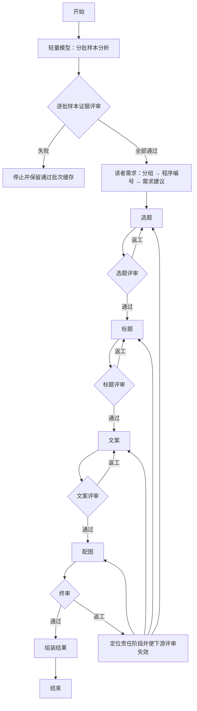

# LangGraph 创作流程实现说明

日期：2026-10-23（北京时间）。本说明对应新增的可切换实现，原 `legacy` 和 `multi_agent` 流程保留。L1：`342bbe7`；L2：`8af251d`；L3：API、页面和数据库快照接入已完成，随 `feat: 接入可切换的 LangGraph 创作与状态持久化` 归档。

页面默认保持此前生成方式，在“高级生成选项”选择“LangGraph 分阶段创作与评审（试用）”后，请求携带 `analysis.workflow=langgraph`。请求前后及节点结束时，`creative_runner.py` 将完整可序列化状态保存到 `Task.payload.graph_state`，并在同一数据库提交中保存兼容的 `pipeline`；失败、取消和服务重启中断同样更新快照。报告沿用版本 3 的阶段/评审结构，避免额外复制一份全局状态；用户归属和文件下载权限仍执行现有检查。

## 1. 状态与职责

`backend/app/services/creative_graph/state.py` 手写 `CreativeGraphState(TypedDict)`，集中保存搜索参数、样本、创作配置、各角色的产物/评审、返工计划、进度记录和最终结果。样本分析和样本证据评审共享 `sample_analysis` pipeline 阶段，但分别拥有独立 Agent、LangGraph 节点和状态字段。各节点有独立的局部更新 TypedDict：

| 节点 | 可更改的业务字段 |
| --- | --- |
| 样本分析 | `sample_analysis` |
| 样本证据评委 | `sample_review` |
| 读者需求 | `audience` |
| 选题 / 选题评委 | `topic` / `topic_review` |
| 标题 / 标题评委 | `title` / `title_review` |
| 文案 / 文案评委 | `copy` / `copy_review` |
| 配图 / 终审 | `image` / `final_review` |
| 返工控制 | `revision_plan`、失效的下游评审 |
| 结果组装 | `result`、`metadata` |

节点还可以更新 `pipeline` 审计快照和 `revision_plan`。节点接收输入状态的副本，返回局部更新；运行时检查返回字段是否属于其更新 TypedDict，越权写入立即停止。业务产物只从 StateGraph 当前状态读取，持久化镜像不作为另一套消息管道。

## 2. 每个 Agent 的结构化响应

`backend/app/schemas/creative_graph.py` 手写各角色响应 TypedDict 及嵌套类型；读者需求内部另分为受众分组响应和动态限定 ID 的需求响应（见第 8 节）。`agents.py` 逐一构建，例如：

```python
StructuredAgent(
    model, COPY_AGENT,
    response_format=responses.CopyResponse,
    output_model=legacy.CopyVariants,
    state_fields=("input_fingerprint",),
)
```

`StructuredAgent` 是本项目的无工具角色封装，内部调用 LangChain 模型的 `with_structured_output(TypedDict, method="json_schema", strict=True)`。`model.py` 继承 LangChain `BaseChatModel`，把完整 Schema 作为原生 `response_format` 请求参数传给已有兼容接口；单次角色调用只发送一次模型请求。这里没有采用会额外调用一次格式化模型的 ReAct 工具循环。

Schema 通过 TypeAdapter 从 TypedDict 生成，保留 Annotated 长度、数量和枚举约束，再由 LangChain 转换；响应必须是完整 JSON，经 TypedDict 运行时校验后适配旧 Pydantic 业务检查。模型和服务端必须支持严格 JSON Schema，不能以 HTTP 200 推断其能力；不支持时明确失败，不静默降级重发。

版本号、输入指纹、总分、通过名单和标题选优是程序字段。模型只返回本角色的内容或评分，程序从当前调用的状态绑定版本和指纹，避免要求模型抄写哈希造成无意义的交接失败。来源、数量、对象 ID、原文引用及返工范围仍需业务检查，框架和 Schema 不能证明这些关系或内容质量。

## 3. 实际图结构

`workflow.py` 使用 `StateGraph(CreativeGraphState)`、`add_node`、`add_edge`、`add_conditional_edges` 和 `compile()` 构建图。评审通过/返工由条件边选择：



终审返工保留完整稿件，只修改问题对应 ID。选题修改会影响同组选题下的标题/正文/配图；标题变更或改选会重新绑定同组正文和图片；正文修改会更新对应配图。无关内容保持原文。每个角色从全局状态选取必要输入，模型不接收数据库会话、凭证、文件句柄或不需要的工具。

## 4. 限制与错误处理

- 首轮请求预算估算现包含每个样本批次各一次分析和语义评审，再加读者需求、选题/评审、标题、文案/评审及逐篇配图/终审请求，并预留有限重试余量；批次越多，样本前置调用越多。上限为 512 次。预算估算不是实际请求承诺，缓存复用、返工和失败会改变消耗。每个生产阶段最多两次质量返工，LangGraph 每轮执行窗口为 90 分钟（包括主动接续），原 `multi_agent` 仍为 30 分钟；窗口到期不再开始新请求，单次连接/读取超时仍为 10/180 秒。
- 格式修复最多一次，与质量返工分开计数；修复也传相同 Schema。临时网络故障（连接/读取超时、连接中断、HTTP 408/429/500/502/503/504/524）在当前请求最多额外重试 3 次，合计最多 4 次，通常等待 15/30/60 秒。服务端 Retry-After 更长时遵循其等待时间；超过 300 秒则停止自动重试，避免提前重发。400/401/403、Schema 不支持、结构/业务错误不进入网络重试。
- 每次网络请求都计入任务记录的总预算；等待中每秒检查取消和当前流程的执行窗口，预算或取消优先于重试。每次读取超时仍是 180 秒，自动重试可能增加总时间与费用，已超时请求可能在上游完成。进度和 `stages.*.metadata.network_attempts` 保存角色、尝试次数、耗时、原因与重试安排，终端输出同样带任务关联。
- `creative_time_exhausted` 表示本轮执行窗口到期；`creative_budget_exhausted` 表示累计请求次数耗尽，两者同时达到时次数限制优先。LangGraph 另保存 `metadata.budget_exhaustion`，含原因、经过秒数、时间上限、已用/最多请求数；终端记录同样的诊断，不再把两种原因混成一条提示。
- `creative_schema_invalid`：JSON 或 TypedDict 字段不符合；`creative_handoff_invalid`：来源/数量/ID/返工范围等动态检查失败。样本评委对语义证据不支持或来源范围有误时，保留摘要草稿和已完成批次，并允许从 `sample_review` 失败节点继续；其他业务交接失败仍按原接续策略处理。`creative_quality_exhausted` 表示内容评审达到返工上限。进度快照保留区分后的原因和尝试记录。
- 请求前后、节点完成和错误退出都保存状态；停止与异常竞争时优先保存停止状态。已发出的模型请求不能撤回，停止后不提交最终结果。
- 保留单进程后台任务和重启后标记中断的行为；没有 LangGraph checkpointer、重启自动续跑或分布式调度。新增的是用户主动发起、基于已保存完整全局状态的模型失败接续，见下一节。
- 未自动调用真实模型、小红书、生图或发布接口。离线验收不能替代真实标题、文案和图片方案的人工可用度验收。

## 5. 从模型失败或执行超时处继续

`POST /api/xhs/creative/runs/{task_id}/resume` 无需提供素材、状态或创作参数。仅允许当前用户自己的失败 LangGraph 任务，通常要求模型连接/读取/HTTP/响应解析问题，或累计请求次数未用尽的执行窗口到期；素材、Schema、一般业务交接、质量、取消、请求次数耗尽和缺失快照不允许从此入口绕过。已有标签 Schema 兼容例外仍只针对明确的旧版“恰好 6 个”标签错误。新增样本语义评审的特例：只在失败角色确为 `sample_review` 且错误文本匹配来源/claim 语义核验时，允许从该评委节点继续；已完成摘要及通过的评审批次保留，失败批次重新评审。页面任务详情通过 `resume_available` 显示“从失败阶段继续”。HTTP 鉴权/参数错误可以先修正原模型配置再手动接续，但不自动重试。

接口从服务器保存的 `graph_state` 创建关联分析子任务，保留父任务失败记录，校验搜索、素材、创作配置和快照一致性。使用原模型配置 ID、标题/正文数量和创作要求；修改创作要求需重新生成，不能把旧评审用于新要求。生产者和评委分别定位，例如标题已生成、标题评审遇到 524 时只从标题评审启动。更早的快照没有 failed_role 时根据当前稿件与待返工计划推断；不完整快照拒绝接续。

新图通过 START 条件边进入恢复节点，继续使用全局 TypedDict、节点局部更新、后续评审和定向返工边。前面的结果直接复用，失败的生产者若正处于质量返工，则保留相同对象范围和已计入的返工次数；网络失败不额外消耗质量返工机会。

所有网络重试和接续累计计入任务保存的请求上限，不清零。新任务按样本批次、标题/正文数量和视觉批次估算，最低 72、最高 512 次；失败接续保留原上限，服务重启中断快照可能按当前批次估算调高上限。旧 `multi_agent` 工作流仍使用 36 次预算。每次主动接续重新开始 90 分钟执行时间窗口，并重验和复用输入仍匹配的已完成批次。累计请求次数耗尽必须新建分析任务。接口通过事务和乐观更新避免重复点击创建多个并行接续子任务；重复请求返回已存在的等待/运行/完成子任务，已失败子任务要从其自己的详情继续。

`resume_available` 只表示快照与错误满足接续条件，不保证模型配置仍有效或下一次请求成功。接续不会重新采集、自动更换模型或跳过内容评审；可能再次产生模型费用。

## 6. 评审引用约束

标题、正文和终审的评审响应使用按当前 LangGraph 批次生成的 TypedDict：`criterion` 枚举来自当前 `rubric`，`field` 及评分定位字段枚举来自当前 `items[].fields`，`item_id` 与关联对象枚举来自当前批次对象。该动态类型通过 `with_structured_output(..., method="json_schema", strict=True)` 转成原生 `response_format` 并发送给模型，避免模型输出 Schema 结构正确但引用不存在字段的问题。程序仍运行动态业务校验，检查每个对象自己的字段集合、评分项完整性、引句、来源、对象覆盖和关联范围。

LangGraph 在模型响应解析后从当前状态绑定 `revision` 和 `input_fingerprint`，所以这些状态所有权字段不属于模型输出 Schema。批次内字段枚举是该批全部对象字段的并集；跨对象误用字段仍由逐对象业务校验拒绝。固定 TypedDict 保留为 Agent 默认响应声明，实际评审请求使用批次专属动态 TypedDict。旧版 Agent runner 当前仍使用原静态契约。

## 6. 标题评审的请求减压

本轮针对出现 524 的标题评审节点减压。标题生成完成后，图按选题构造轻量评审输入：关键词、创作要求、当前选题、对应受众摘要、标题风格摘要、候选标题和固定 rubric，移除重复的完整上游分析。每个请求最多评审 5 个候选；同一选题的 6、7、8 个候选分别拆成 3+3、4+3、4+4，避免留下没有比较对象的单项批次。

标题评委使用独立的 `TitleReviewResponse` TypedDict，只返回六项分数、简短评论、问题、保留点和候选比较。程序随后将它适配回既有 `ItemReviewResponse`，继续执行字段引用、引句、低分问题、完整覆盖和确定性选优检查；总分、通过状态和最终选中的标题仍由程序计算，不交给模型决定。标题评审的原生 JSON Schema 仍通过模型的 `response_format` 参数传递，提示词不再重复嵌入完整 Schema。

每个已完成批次以输入指纹写入 `pipeline.stages.title.metadata.title_review_batches`。失败接续或同一节点重试时，已经完成且仍匹配当前输入版本的批次直接复用，只调用未完成批次；输入、版本或业务校验不匹配时缓存自动失效。该策略通常把一次约 15 个标题的大请求变成多个小请求，目标是减轻单次请求负载；真实 524/读取超时能否减少仍待试用。3 个选题大致会产生 3 次标题评审调用，总请求数从 10 次增加到 12 次左右，仍受全局 36 次预算约束。同一选题超过 5 个候选时只在各自批次内比较差异，跨批候选差异暂不由评委直接比较。

标题评审的 `severity` 在动态 Schema 中仍是 `blocking` / `suggestion` 枚举。由于“分数低于某个评分项门槛时必须阻断”是跨字段关系，Schema 枚举本身无法表达；`expand_title_review()` 在进入通用业务校验前，只对已经存在的对应问题执行确定性提升，将阻断评分项的 `suggestion` 改为 `blocking`。缺少问题、错误评分项、错误字段、错误引句和未知关联仍然失败，不降低质量门槛，也不影响旧版评审。

## 7. 样本引用失败的原句诊断

2026-10-22 按用户要求扩展此前只记录位置/原因的诊断。样本分析的 `observations[*].quote` 或四类 patterns 的 `evidence[*].quote` 未通过连续原文校验时，终端增加“原文引用不匹配”事件，携带任务、角色和尝试序号；同时把 `quote_diagnostic` 存入尝试轨迹。两次校验均失败时，它随 `metadata.failed_attempts` 持久化，页面“失败详情 → 模型原句与原文对照”可以展开、复制；修复成功的尝试轨迹仍随阶段历史保存。

诊断同时保留结构校验前的模型引句和校验实际使用的引句，避免 TypedDict/Pydantic 的首尾空白处理掩盖差异。模型引句最多 600 字，超过时记录原长度和截断标记；对应样本的标题和独立正文片段各取最多 360 字的近似对照窗口，提供字段、片段下标、窗口偏移、空白/兼容字符归一化后的匹配提示及最多 12 个字符差异块。差异块中的模型/原文文本各最多 80 字，长块有截断标记。换行、制表符以 JSON 转义形式显示。

近似窗口仅辅助排查，不证明模型原本想引用该处；正文首尾片段不会拼成一段，归一化提示也不改变逐字引用的通过规则。原句捕获使用调用级上下文，在异常后恢复，避免不同尝试/任务串用；不记录完整模型响应、提示词或模型凭证。旧任务没有保存原句，无法回溯补出。这次改动覆盖 LangGraph 和原多 Agent 的样本分析，不改变重试次数、评分或业务校验规则。

## 8. 读者需求的两步生成与局部修复

2026-10-22 针对 80 号试用任务的受众覆盖遗漏、未知/重复分组引用改造。`services/creative_graph/audience.py` 在原 `audience` 图节点内执行两个独立结构化调用，分别使用专用角色提示词；对外仍只更新 `AudienceUpdate` 允许的 `audience`、`pipeline` 和 `revision_plan`，不新增全局字段或恢复角色，兼容已有任务快照。

第一步使用手写 `AudienceGroupingResponse(TypedDict)`，只让模型生成受众分组的语义内容，不要求返回用户词总表或分组 ID。程序校验每组受众词和证据来源，反馈具体缺少的受众词与错误字段；全部覆盖后按组顺序分配 `segment_1`、`segment_2` 等 ID，并原样回填用户受众词。

第二步在构建 Agent 时明确 `response_format=AudienceNeedsResponse`。该类及嵌套类均继承 `TypedDict`，按本次合法 ID 特化引用字段的 `Literal`，真实请求的 `response_format.json_schema.schema` 包含合法 ID 枚举（单 ID 时为 `const`）和 `uniqueItems: true`。本地 TypeAdapter 同时检查合法值与唯一性，不能仅依赖模型服务执行 Schema。模型只写共性需求、形式建议、摘要和限制；程序合并回既有 `AudienceBrief` 后继续执行来源、受众覆盖和上下游检查，Schema 不替代这些业务校验。

每步仍最多两次结构/交接尝试。第一次出错时，逐项检查并保留合格分组、需求、建议和顶层文字，把错误字段、缺失词、收到的错误 ID、合法 ID 和待补数量反馈给第二次调用。修复请求只需返回替换/新增的列表项；无需补充的列表可返回空列表，合格部分由程序合并，顶层已通过文字保持不变。最终需求与建议仍至少一项，且不能通过删掉坏项目来跳过应补数量。若模型把八个分组名额用在过细的分组上，只释放补齐全部用户受众所必需的尾部分组名额，并告知需要重新合并的词。

`pipeline.stages.audience.metadata.audience_steps` 保存版本、输入指纹、已校验分组、合格分析和待补数量；分析另绑定完整分组内容的指纹，避免 ID 相同而分组语义已变时误用旧建议。复用前重新校验；需求调用失败或修复途中断网后，从原 `audience` 角色接续时复用分组并补齐尚未完成的分析。沿用原接续资格：只有模型服务/连接类失败可手动继续，Schema、业务、素材、质量或预算失败仍不能绕过检查。旧任务没有这些中间结果时，从该节点完整执行两步。

终端增加“受众分组局部修复”和“受众需求局部修复”事件，显示具体缺失词、错误位置、错误/合法 ID 与已接受项目数；分组和分析的调用日志分别显示子步骤名称。TypedDict 拒绝的解析对象只在当前调用内用于筛选合格项，不持久化完整失败响应。修复仍受全局请求预算、网络重试、取消和超时约束；正常链路比此前增加一次模型请求。应用已提供本地试用入口，真实模型成功率和成稿可用度尚待用户验收。

## 9. 正文评审按锁定标题分批

2026-10-23，85 号真实 LangGraph 任务已经生成 9 篇正文，`copy_review` 连续四次请求各约 127 秒后收到 HTTP 524，未返回评分。重建其输入约 2.6 万字符（用户消息含重复 Schema，不含独立的系统消息和 API Schema 参数）；正文与评审在页面同属一阶段，不能据页面阶段名推断正文生成也失败。

新增 `services/creative_graph/copy_review.py`，在原 `copy_review` 图节点内，按当前锁定标题将对应的 2～3 版正文放在同一批比较。每批保留该组选题、锁定标题的承诺/支撑点、主要受众摘要、相关样本的风格/价值/避坑依据及限制；移除完整受众分析、其他选题和标题、无关样本及重复 Schema 文本。正文、标签、覆盖点、来源完整保留，样本依据的引句不截断；原生 JSON Schema 继续通过实际 `response_format` 传参。`CopyReviewResponse(TypedDict)` 的 `reviews` 数量约束同步收紧至 2～3，运行时校验与独立角色提示词仍生效，不采用隐藏格式化调用或降级。

使用相同 85 号快照离线重建，三批用户消息分别为 8262、8195、8379 字符，每批 3 个对象、18 项评分，原先单次为 9 个对象、54 项评分。这是请求规模比较，不是已测得的性能或成功率。评分项目、门槛、阻断规则、逐字引句、来源和对象覆盖校验均不变；每批先校验，再合并为原来的 `ItemReviewResponse`，绑定原完整输入指纹并重验全部对象覆盖与确定性评分，确保后续配图仍验证同一正文集合。关联版本只允许引用同批同标题的其他版本。

批次结果保存至 `pipeline.stages.copy.metadata.copy_review_batches`，含版本、原完整输入指纹与按批指纹索引的已校验响应。每次执行先重验缓存，清除损坏、版本/输入不匹配和多余结果；模型错误接续时仅调用未完成批次。正文/标题/风格/版本变化导致旧评审失效，不跨版本复用；已完成的一批即使包含不通过的版本，也先保存并评完其余批次，再走既有质量返工条件边，不跳过坏版本。

标题评审按既有标题组与候选批次拆分，正文评审保留同一锁定标题下的 2～3 个版本作为组内比较单元；不同批次之间没有交叉依赖，因此两个评委节点现在都最多三路并行。每批校验和缓存后仍按准备时顺序合并，完整评审结果再次执行原全量校验，再进入原条件路由。进度快照与并行结果缓存共用 checkpoint 锁；批次进度字段记录最近实际启动或复用的批次；接续只补缓存中不存在或重新校验不通过的批次。并行不减少调用数量，组内版本比较语义及评分门槛保持不变。

进度显示“文案评委 Agent · 评审批次 1/3”和完成批次数；终端模型调用记录批次下标、对象数、评分数量，复用时新增“复用正文评审批次”事件。旧失败快照没有批次缓存时自动从第一批评起，因此 85 号任务可通过现有“从失败阶段继续”入口复用前面阶段及 9 篇正文；不会修改原失败记录或重新采集。仍遵守累计 36 次预算、网络额外重试 3 次、180 秒单请求读取超时和取消逻辑。默认 3 选题正常链路从上轮 13 次增加到 15 次；虽然单次负载下降，总调用数与费用可能增加，真实效果待用户试用。旧 `legacy`、`multi_agent`、前端默认生成方式及报告格式不变。

## 10. 配图与终审逐篇处理

2026-10-23，86 号任务已生成 9 篇正文并完成正文评审，配图阶段连续三次在约 127 秒返回 524，随后触发整条流程 30 分钟预算。新增 `visual_batches.py`，在原 `image` 和 `final_review` 图节点内部按 `variant_id` 顺序执行，每次只处理一篇正文；不新增全局业务字段或恢复角色。

配图请求保留当前选题、锁定标题、完整正文/标签/来源、用户要求和视觉偏好；移除其他正文与选题。手写 `ImageResponse(TypedDict)` 的 variants 固定一项，专用内部 `ImageBatchOutput` 接受单项批次，合并后仍使用要求完整 2～15 项的原 `ImagePlans`，重验指纹、覆盖、顺序和绑定。每篇仍可给 1～6 张具体图片方案，不为缩短请求截断提示词。86 号输入离线重建从 10447 字符变为 9 批，每批 2195～2412 字符（仅输入对象，不含系统消息与 API Schema）；不代表真实耗时或成功率。

终审请求保留当前完整的选题、标题、正文、标签、配图和素材说明，以及相关样本文字证据与字段责任表；移除在上下文中重复的正文/配图集合。`FinalReviewResponse(TypedDict)` 的 reviews 固定一项，评分、低分问题、引句、来源与责任阶段检查继续执行；全部批次合并后，用原完整输入再次校验覆盖及质量判定，再走原条件路由。逐篇终审不比较跨篇重复性；正文阶段的同标题版本比较仍保留。两类角色均通过实际 `response_format` 传原生 Schema，用户消息不重复嵌入 Schema。

`batch_runner.py` 将合格结果保存于 `stages.image.metadata.image_batches` 和 `stages.final_review.metadata.final_review_batches`，按批指纹索引，另绑定完整输入、策略版本及返工指纹。接续前重新检查缓存，丢弃损坏、过期或多余项；只补未完成批次。进度显示当前篇数、完成/复用篇数，终端输出相同批次定位。完整配图/终审业务状态只在所有批次完成后提交；中途取消或失败保留先前稿件与已完成批次。

图片策划和终审各自最多同时处理 3 篇；每篇请求仍是独立上下文，不做跨篇比较。结果按原正文顺序合并，无论模型响应先后如何。批次缓存写入、完成数更新和 checkpoint 深拷贝共用同一把可重入锁；失败时停止尚未启动的批次，等待中的调用若成功仍先入缓存，接续时只补缺失批次。该并发只缩短可重叠请求的墙钟等待时间，不减少模型调用数，也不保证上游服务不会对并发限流。

配图返工只发送目标 variant，携带该篇旧配图与相关反馈，其余图片由程序原样保留；合并后再执行全量返工范围校验。上游修改或改选标题仍按原依赖规则重新绑定。默认 3 选题 × 3 版本首轮从 15 增至 31 次调用；最大配置需 47 次，所以新任务预算设为 72 次，旧任务预算不升级，30 分钟/180 秒和重试规则不变。费用与总耗时可能增加，仍需真实试用；86 号记录为预算耗尽，不能用模型失败接续入口，可选择已有采集内容新建生成任务。原任务不被修改或自动续跑。

## 11. 按角色裁剪上下文

有界原文摘录只发送给样本分析和逐批样本证据评委；后续节点使用通过评审的样本分析简报，且原实现已经按预算提取首尾片段，并非把全文传遍所有节点。读者需求使用样本分析简报；这次继续解决后续生产节点重复携带整份分析、受众证据和重复 Schema 的问题。

新增 `context.py`，在模型调用前为选题/标题/正文构造字段白名单投影，完整样本、来源和上游产物保留在服务器全局状态中，用于指纹、业务校验、报告和恢复。投影不修改原始数据、不重新调用模型生成摘要、不按字符硬截断事实或风格句子；现有分析结论作为简报使用。未使用的字段即使将来加入全局状态，也不会自动进入这些请求。

| 角色 | 实际接收的样本信息 |
| --- | --- |
| 样本分析 | 采集正文的有界片段与元数据 |
| 样本证据评委 | 当前 2～3 篇样本摘录、对应分析结论、引文和来源 ID；逐条语义评审，不要求结论逐字照搬原文 |
| 读者需求 | 样本分析简报和可核对的分析引句 |
| 选题 | 主题/读者价值观察、主题/价值/避坑结论、来源 ID 和受众需求摘要，移除原文引句与表达风格证据 |
| 标题 | 标题风格结论、风格摘要、选题承诺/边界、相关读者摘要，不带样本逐篇观察和原文引句 |
| 正文 | 口吻、开头、段落、表情、结尾等风格结论、避坑、锁定标题承诺、选题要点、相关读者摘要，不带原文引句或上游完整评审 |
| 配图 | 当前成稿、锁定标题、选题边界、视觉偏好及当前选题绑定的获批结论；无采集正文或全量样本分析 |
| 评审 | 当前评审对象与必要样本分析/证据；正文与终审按相关来源裁剪，标题按风格摘要判断 |

样本分析完成后，LangGraph 在读者需求前执行独立的 `sample_review` 节点。claim ID 按批次和项目序号由程序生成；response format 为每个 claim 创建独立 TypedDict 分支，以 `anyOf` 同时限定该条程序 claim ID 和它自己的来源 ID，避免只允许本批来源集合却让来源跨 claim 串用。本地代码仍检查 ID 覆盖、重复、逐条来源绑定和拒绝项不得携带引用；单条 `supported=false` 是语义淘汰而非格式错误，不重试整批。每批最多三路并行，已完成结果按输入指纹缓存；失败接续复用通过批次，只补失败或缺失批次。旧全局状态缺少 `sample_review` 时会迁移，并在任何后续 Agent 之前补跑评审。轻量模型只用于样本分析，语义评委使用原主文字模型。

评审批次均完成后，程序会把各批 claim 与评委决策合并为全局状态 `sample_review.approved_claims`。注册表只包含程序生成的 `claim_id`、结论文本、评委支持的来源 `note_ids` 和简短评审依据，不采信模型自报的 ID 或来源范围。另生成 `approved_analysis`，过滤被拒观察/模式，后续读者需求、选题、正文等使用它，而非原始 `sample_analysis`；原始输出与批次缓存继续保留用于审计和失败接续。至少需要 3 条获批结论、覆盖 `max(3, ceil(筛选后样本数 × 30%))` 个来源才进入下游；覆盖不足使用 `creative_sample_evidence_insufficient` 并在阶段 metadata 留下统计和逐项淘汰原因。若该覆盖门槛通过但主题模式全被淘汰，最终报告用“暂无通过评审的主题模式”占位，不恢复未获批内容。任务进度可展开查看通过/淘汰统计与原因。通过状态但没有新注册表/简报的旧快照会利用缓存批次本地重建，不重复调用模型。并行批次缓存写入与快照复制共用锁，避免进度保存时发生共享字典竞态。选题、标题、正文、配图与终审已逐步绑定该注册表；后续各角色只接收当前对象关联的精简子集，不再重读全量样本原文。

LangGraph 的读者需求分组和需求/形式建议子节点都使用该注册表。动态 TypedDict Schema 将 `claim_ids` 限制为当前获批 ID；本地校验确保样本证据的每个 `note_id` 都属于其引用的 claim。用户要求类证据不能伪造样本 claim/source；假设类证据若借用样本，也必须给出相同的 claim/source 绑定。模型只接收 claim ID、结论、来源和类别，不接收评委解释；既有非 LangGraph 路径仍兼容没有 claim ID 的历史产物。

选题 Agent 只接收与创作方向相关的获批 claim 子集；其 response schema 对 `claim_ids` 使用本次输入的动态 Literal，程序再核对每个 note 是否属于所引 claim。选题评委的评分/问题来源由程序进一步限制在当前选题已绑定的来源集合，不因某 note 在全局样本存在就允许跨选题引用。该注册表仅沿标题、正文和配图准备/评审过程中重验选题评审指纹的调用链传递；不会自动扩散进这些生产节点的模型上下文。没有注册表的旧产物不注入空 claim 字段，以维持旧选题评审指纹可校验。

生产角色提示词明确简报是分析结论、来源 ID 不等于原文，不得声称读过完整原文或原图。选题、标题、正文和选题评审也停止在用户消息中重复嵌入输出 Schema，原生 `response_format` 及运行时校验保留。返工仍携带必要的旧稿和评审反馈，以执行只修改目标对象的范围约束。评审基于分析引句而非完整原文，不等同全文事实核查或抄袭检测。

用 86 号已有快照离线比较输入对象，选题从 12209 降至 6036 字符，标题从 15787 降至 6065 字符，正文从 16745 降至 8140 字符；不含独立系统提示词与 API Schema。本轮没有新增模型调用或编造真实耗时收益。

## 12. 新生成正文最多 500 字

三种生成方式的新正文以 200～400 字为通常目标，简单内容允许更短，没有硬性最低字数；上限为 500 个 Unicode 字符，空白、标点、换行计入，标题和独立标签另算。这是本工具的创作约束，不是对平台发布上限的声明。

LangGraph 的手写 `CopyVariant(TypedDict)` 将 body 的 `maxLength` 设为 500，原生 Schema 与本地 TypeAdapter 一致执行。原综合生成和旧多 Agent 在发送模型请求时使用限制到 500 的 Schema 副本，并在新响应验证时检查长度；不修改通用历史读取模型原来的 3000/6000 字上限，历史长正文仍可读取、导出及作为下游检查资料。

超长返回进入原有一次格式/交接修复，提示具体字段与 500 字要求，保留承诺和完整句子；两次仍超长则按原失败方式停止，不静默截断、不放过超长结果。标题、标签、配图提示词有各自原来的长度规则。新生成或返工的输出执行新约束，旧任务此前已经完成的正文不会被自动改写。

## 13. 串行分批流程的时间预算与接续

2026-10-23，88 号真实任务在约 30 分 8 秒后以旧错误 `creative_budget_exhausted` 停止，已用 31/72 次请求。标题有一轮质量返工，配图遇到一次 HTTP 500 后重试成功；终审本身未记录网络失败，已经完成并保存 4/9 篇，在准备第 5 篇调用前触发 30 分钟总预算。因此本次直接失败原因是本地执行窗口到期，并非已确认的终审请求过大或 HTTP 524。

用保存快照离线重建，9 篇终审输入对象为 8414～9964 字符（不含独立系统消息/API Schema），第 5 篇为 9440，前四篇缓存均通过重新校验。此次不再拆分终审或放宽质量门槛；改为 LangGraph 新建及主动接续均使用 90 分钟窗口，区分时间耗尽与次数耗尽，并允许符合快照和剩余次数检查的旧时间超时任务主动接续。88 号可复用前四篇，只调用第 5～9 篇；若后续终审提出阻断问题，仍按原条件边返工，不能保证只需五次请求即可成稿。86 号等旧记录也需通过相同检查，不更改其原次数上限。

这是执行窗口，不会撤回已经发送的请求；正在进行的请求仍受 180 秒读取超时控制，完成后可保存本篇结果，下一次请求前再检查窗口。用户主动接续会重新计时，累计请求次数和质量返工次数不重置。未自动发起真实模型接续，真实成稿仍待用户试用。

## 14. 每版正文选择最相关的话题

三种生成方式统一要求：先完成本版正文，再优先选择 5～8 个与本版最终正文最相关的话题，按相关性从高到低排列；不再硬编码恰好 6 个。优先正文实际涉及的主题、服装品类、风格、技术或应用场景；不直接复制搜索关键词、样本标签或目标受众清单，不添加正文未涉及的行业和引流热词。不同正文版本各自选择，允许有相关标签重合；正文返工时同步重新选择。标签仍独立保存在 `tags`，内部会去除井号、空白和重复项；页面、复制和日报导出统一输出为小红书格式的 `#标签`。

新生成的标签 Schema 采用 5～8 项范围，不再要求恰好 6 项；模型返回后先规范化井号、空白和重复项，再检查有效数量。历史 Pydantic 模型仍保留 1～10 项读取兼容性，避免旧文案无法打开。标签语义相关性由生成和评审提示词约束，无法仅靠 JSON Schema 证明“最相关”；文案/终审评委对照当前正文检查，不因合理的不同排序单独阻断，也不修改评分门槛。

历史读取模型的 1～10 项限制不变，旧结果、导出、旧稿件的下游检查及有效批次恢复保持可用；未完成的生成/正文返工会采用新规则，已经完成的旧文案不会自动补齐标签。新规则的真实相关性仍需用户试用验收，没有发起真实模型调用。

## 15. 历史任务分页

创作页历史任务接口 `GET /api/xhs/creative/runs` 不再固定只读取最新 30 条，改为按 `page`（从 1 开始）和 `page_size`（1～100，页面默认 20）查询当前用户的搜索、采集和分析任务。响应同时返回 `total`、当前页和 `has_more`，查询仍按任务 ID 倒序并保留用户隔离。

前端历史区域显示总数和分页控件，可翻页或快速跳页查看全部历史；刷新会保留当前页。打开某条记录仍按原详情接口读取，不把完整任务 payload 放进历史列表。旧接口不带参数时仍返回第 1 页 20 条，已有调用只需读取 `items` 也能兼容；本次未改写历史数据。

## 16. 大批量样本分析分批处理

用户反馈的 22 篇分析记录（任务 92）在 `sample_analysis` 累计用掉 2 次模型请求，分别耗时约 44 秒和 93 秒，错误是引用证据未通过逐字校验，不是日志记录到的 HTTP 524；但 22 篇原文仍在一个请求中要求逐篇观察和跨样本归纳，输入/输出规模会放大时延与格式/引用失败风险。

LangGraph 样本数超过 3 时，`prepare_sample_batches` 将来源均分为 2～3 篇的连续批次，22 篇为 3+3+3+3+3+3+2+2。逐批用原生 `SampleAnalysisResponse` 生成对应观察、局部模式和原文证据，并在批内立即按原有来源覆盖与逐字引用规则校验。公共输入仍要求至少 3 篇；只有拆分后的尾批允许 2 篇，TypedDict/Pydantic 响应契约对此作了内部兼容。全部批次完成后程序确定性合并观察、相同结论的证据、风格维度和局限；不会把全部原文再次送入一个全局汇总请求。3 篇以内仍保持原来的单请求路径。

用任务 92 保存的同一批素材离线重建，原单条用户消息约 23164 字符；改为 8 批后每批最多 3 篇，单批消息会进一步下降（含 Schema，不含独立系统消息/API Schema 参数），不是实时模型耗时测试。已完成批次会继续按输入指纹缓存，失败时只重试当前未完成批次。

每个成功批次在 `stages.sample_analysis.metadata.sample_analysis_batches` 中保存版本、完整批次指纹与已校验输出，并立即 checkpoint；接续时重验缓存，只重试未完成或损坏批次。请求次数仍逐个累计，单次 180 秒读取超时、网络重试、引用硬校验和既有格式修复规则不变。批次增加请求次数和总耗时，降低的是单次输入/输出规模；不能保证模型每批引用都正确，也不保证中转服务一定不超时。该实现仅用于 LangGraph，旧综合/多 Agent 流程未改。

## 17. 样本相关性筛选

在样本分析前，`creative_agents/sample_relevance.py` 按搜索关键词、用户受众以及 AI、服装/时尚、电商视觉/营销等主题词进行确定性规则预筛，不额外调用模型。命中多个主题组且达到高相关门槛的来源进入主要样本；只命中部分主题的边界来源进入弱相关层；没有有效主题关联的来源排除。相关性分数只用于路由，不代表内容质量或热度。用户的受众字段参与匹配，但关键词和行业词有歧义时仍可能误判，真实使用中需要查看筛选记录。

高相关来源保留给既有分析输入准备器处理（每篇正文仍最多截取 1,800 字符，并受总预算约束）；弱相关来源在送入准备器前缩短到最多 500 字符，保留首尾，并在模型输入标记为 `relevance_tier=weak`、记录原始字数/截断状态，提示模型不得将其与高相关样本等权计数或单独支撑共性结论；明显无关来源不进入模型请求。筛选后不足 3 篇时，在不发起模型请求的情况下以 `sample_relevance_insufficient` 明确失败。高相关不足 3 篇但连同弱相关达到 3 篇时可以继续，模型只把弱相关作为有限参考。

`CreativeGraphState.sources` 始终保留全部原始采集数据；筛选只生成送模型的副本，不改写原文、note_id 或历史任务素材。`pipeline.stages.sample_analysis.metadata.sample_relevance` 保存规则版本、数量、逐篇 ID/层级/分数/命中词/简短原因，以及弱相关和排除 ID，不保存被排除正文。大样本分批沿用筛选后输入；缓存指纹纳入筛选规则版本，策略变化时不会复用旧批次。该筛选目前仅用于 LangGraph 样本分析。

## 18. 样本证据校验容错

针对任务 94 中“空白格式被规范化”和“标题引用错标为正文”导致两次返工耗尽的情况，样本分析提示词与校验规则现允许忽略引用内部的空格、换行和制表符差异，并将已接受的引用规范回来源中的原始片段；文字字符仍需连续对应，不接受改写、跨正文片段拼接或引用未传入的中间正文。

对于 `evidence.field`，若模型标注的字段不匹配，但引用只能在同一笔记的标题或正文其中一个字段找到，程序自动纠正字段并继续校验。模型把标题前缀和正文短语拼在一起时，程序会在指定的单一字段内提取最长的真实连续片段（至少 8 个字符），再把恢复后的片段写回结果；这不是模糊相似度放行。完全找不到原文、跨首尾片段或只有过短片段时仍失败。观察项引用也使用同一恢复规则。归纳结论本身允许模型概括改写，但保留下来的证据必须能回到本次输入的原文片段。

## 19. 全链路动态来源 Schema

样本分析阶段的契约现在贯通到所有依赖来源的 LangGraph 节点。`sample_schema.py` 按当前批次生成样本分析 TypedDict，允许 `summary`、`finding`、风格结论等内容归纳改写，但 `observations` 和 `evidence` 的 `note_id` 只能取本批输入的动态枚举；样本分析完成后，程序再按原文证据规则校验，不把归纳结论误当作原文引用。

读者需求分组、需求分析、选题、选题评审、正文生成及标题/正文/终审评审分别使用当前状态专属的 TypedDict 工厂。Schema 中的样本 ID、受众分组 ID、选题 ID、标题/正文对象 ID、评分项和字段均来自本次请求，模型不能通过普通字符串发明不存在的交接值。空样本引用列表在不需要样本证据的轻量评审中被固定为长度 0；有样本上下文时仍只允许当前来源。

服务器拥有的 `revision`、`input_fingerprint`、`idea_id`、`candidate_id` 和批次顺序不交给模型决定。模型只返回当前角色负责的内容，节点代码将程序字段合并回全局状态，再执行原有 Pydantic 适配、来源/数量/覆盖/引用/评分业务校验和条件路由。动态 Schema 是第一道格式边界，业务校验仍是第二道关系边界；旧版非 LangGraph runner 保持静态契约以兼容历史任务。

本次改动新增 `source_schema.py`、`sample_schema.py`，并扩展 `audience.py`、`review_schema.py` 与 `agents.py` 的动态绑定。真实中转站是否接受每批动态 JSON Schema 仍需在应用重载后用用户配置的小样本验收；离线测试只证明请求参数、解析和状态交接的一致性。

## 20. 标题返工范围保护与失败接续

标题评审部分批次未通过时，返工请求只允许修改评审指出的 `candidate_id`。程序现在在标题响应绑定程序 ID 后，先恢复所有不在返工范围内的已通过候选，再执行完整的 Pydantic 和返工范围校验；因此模型即使误改已通过标题，也不会覆盖服务器保存的稿件。目标标题仍必须经过正常的 Schema、数量、关联和质量检查。

如果旧任务已经因为该保护上线前的错误进入 `creative_handoff_invalid`，用户可以从失败处接续。接续白名单只匹配“未列入返工范围的已通过内容必须原样保留”这一精确错误，仍要求完整 LangGraph 快照、未耗尽请求预算、状态/用户/素材/模型配置一致；其他来源、数量、ID 或返工范围错误继续禁止接续，避免把真实业务错误当成可重试的模型问题。

本次新增标题返工保护和接续分支测试；后端全量回归 **849 项通过**（1 条既有 LangChain 弃用 warning）。真实任务仍需用户在页面点击失败任务的“从失败处继续”验证，离线测试不代表真实模型一定会生成高可用标题。

## 21. 标题生成绑定获批样本证据

标题生成输入从当前选题 evidence 中读取已获批 `claim_id`，并构造选题专属的 claim/source 注册表。标题 Agent 只收到这些精简结论与来源，不接收原始采集正文、全量样本或评委长解释。每个候选返回 `claim_ids` 和 `source_note_ids`；动态 TypedDict Schema 将两个数组限制为当前选题允许的 ID，程序生成 `candidate_id`，并在本地检查引用非空、无重复、claim 合法以及来源必须属于该候选所引 claim。内部引用保存在图状态，不进入最终可复制标题。

标题评委的精简批次携带当前选题的获批结论和候选 claim/source 绑定，便于对照标题承诺是否有支持；内部 ID 放在 evidence 而非可评分 fields，评委仍只对文案字段评分。标题评审批次版本升为 `title-review-adaptive-v3`，输入指纹改变时旧评审批次不会被错误复用。没有获批注册表的旧式输入使用空引用列表；已绑定的输入则不允许候选空引用或越权引用。

本地关系检查不能判断标题语义是否真的由获批结论推出，这部分仍由标题评委审核；动态 Schema 也不保证所有兼容模型服务都会接受这些 ID 枚举，真实模型的响应和标题可用度仍需用户试用验收。

## 22. 正文生成与评审绑定获批样本证据

LangGraph 正文生成请求根据当前已锁定标题涉及的选题构造获批 claim/source 注册表。动态 TypedDict 将 `claim_ids` 限定为本次请求内获批 ID，来源 ID 限定为获批结论的来源合集；程序随后逐版按对应 `idea_id` 再校验 claim/source 配对，不接受跨选题 claim、空绑定或来源错配。旧的固定 CopyResponse/Pydantic 读取结构仍可读取没有 claim 的历史正文，LangGraph 实际请求使用动态响应类型。

正文评委按锁定标题拆批时携带该选题的获批结论文本，并将每个版本的 claim/source 绑定放在独立 `evidence` 字段；评分 fields 只保留 label、body、tags、covered_points。评委提示词明确 ID 合法并不等于内容语义得到支持，仍须检查正文承诺。评审批次版本更新为 `copy-review-adaptive-v3`，输入指纹变化会使旧批次缓存失效。结果组装只输出用户文案字段，不泄露 `claim_ids`；配图和终审也已接入逐版获批 evidence。

Schema 只验证当前请求允许的 ID 集合，选题与 ID 的交叉配对由本地确定性逻辑校验，以避免多选题联合 Schema 产生额外复杂结构。语义支持仍依赖 AI 评委，需用用户配置的真实模型验证兼容性和成稿质量。

## 23. 配图策划承接获批结论

配图总输入和逐正文版本的 LangGraph 批次都携带当前选题对应的精简获批 claim/source 注册表。图片 Agent 用这些结论理解内容边界和标题/正文主张，不接收原文或全量结论；提示词明确图片是表现形式而非新的事实证据，不得把视觉创意写成已发生的样本事实、原图分析或真实商品/案例承诺。图片方案没有额外的 claim ID 输出字段，因为视觉构图无需伪装成文本论证。配图提示词版本及批次指纹升级，避免继续使用不含获批结论的旧缓存。

本步骤只改善输入的内容连续性与事实边界，不对画面是否可生、商品细节是否准确作自动保证；终审仍需独立检查配图是否支持当前正文。

## 24. 终审核对正文获批证据

每篇终审 item 增加独立 `evidence`，携带该正文版本经过正文阶段本地校验的 claim ID、source ID，以及同一选题对应的精简获批结论文本。终审按获批结论核对正文承诺，并继续检查完整的标题、正文、标签和配图组合。该证据对象不并入 `items[].fields`，因此不能被模型当作可评分/可引用文案字段；现有逐篇评审 Schema、评分项、问题定位和责任阶段路由保持不变。终审批次版本更新为 `final-by-variant-v2`，输入指纹变化会令旧批次缓存失效。

来源 ID 关系已由前序正文/配图输入校验，不因终审模型输出重复校验；语义支持仍由评委判断，不能把合法引用关系等同于事实证明。

## 25. 标题质量返工任务单

标题评委的低分项必须有对应问题，但跨字段逻辑不能由 JSON Schema 单独表达。进入标题业务校验前，适配器会保留模型评分；若某项低于固定 rubric 门槛而没有 issue，程序依据该评分项的固定修订方向、评语和当前标题生成一个引用当前标题的 issue。阻断 rubric 的低分生成 `blocking`，自然度/差异化等非阻断项保留 `suggestion`，评分门槛不变。

标题质量返工会从评审结果生成逐 `candidate_id` 的短任务单，包含低分项、需修改的问题/指令及应保留要点，并作为 `quality_revision` 输入。标题 Agent 只需改目标候选；ID 绑定后，程序恢复全部非目标候选原文。对于目标标题，程序比较去除标点、符号和空白后的文本；仅改标点或格式视为没有进展，进入既有结构化修复重试，仍未修改则按阶段失败保留此前稿件。标题生成本地校验还会拒绝常见未闭合括号/引号、悬空连词/介词和截断标点。

此处提升的是返工意见与候选的绑定清晰度和无进展检测，不保证模型一定能一次修好；内容是否自然、吸引目标受众仍由标题评委和用户真实试用确认。未改变全局两轮质量返工上限、模型请求数规划或旧版 runner。

## 26. 样本分析引用修复尝试

LangGraph 的 `sample_analysis` 单独允许最多 3 次结构/交接尝试；其余角色和旧版 `multi_agent` 的尝试次数不随之改变。引用失败后的修复请求附加当前批次专用提示：`quote` 必须从同一篇样本的同一个标题或正文片段连续逐字复制，不得概括、补写、拼接或用省略号跨过原文；没有直接证据的风格维度不生成。原文引用校验、来源 ID 绑定、观察覆盖与语义评审门槛保持不变。

失败消息记录实际尝试数；每次尝试的原句诊断和批次缓存仍按现有机制保存。额外尝试会消耗请求预算和墙钟时间，仅增加修正机会，不保证 Qwen 或其他兼容模型最终遵守逐字引用规则。真实模型验证须继续检查每批原文引用和下游来源，不以 Schema 通过或 HTTP 200 单独判定链路成功。
